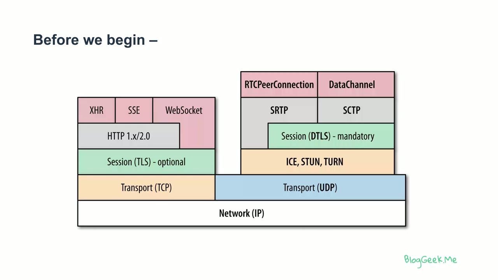
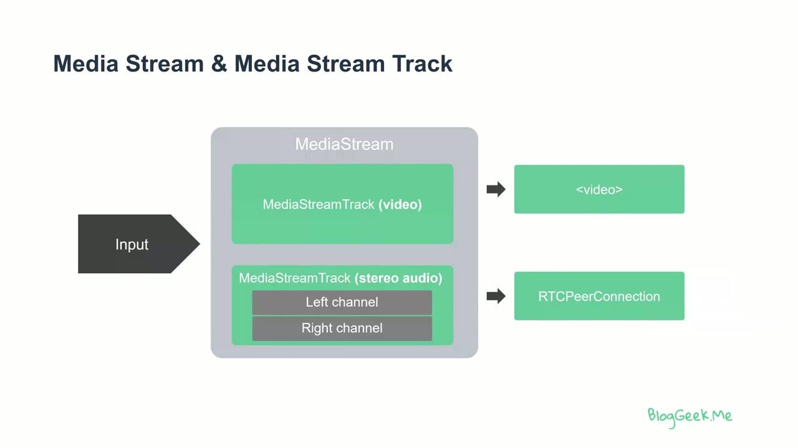
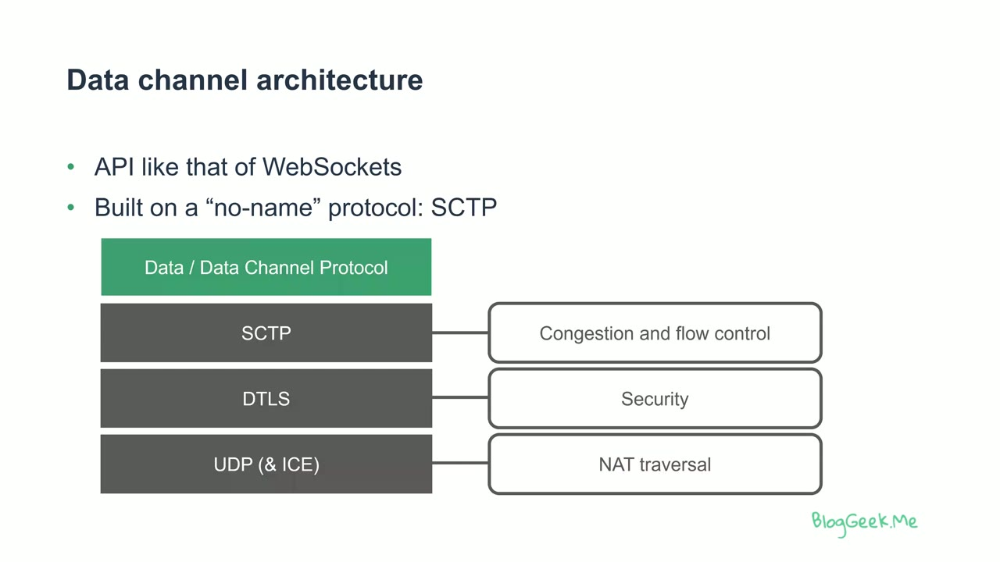

# 第 4 章 WebRTC API 概览

WebRTC 的浏览器能力主要围绕媒体采集、`RTCPeerConnection` 和数据通道展开。本章先建立协议栈的整体认识，再说明设备、媒体流与媒体轨道的关系，随后完整拆解一次提议—应答和 ICE 候选交换流程，最后分析数据通道的协议特性、接口与扩展限制。

## 从协议栈看 WebRTC 的边界

《High Performance Browser Networking》中的一张 WebRTC 架构图把相关技术分成信令与实时通信两部分。这里不依赖原图，也可以按职责理解这套结构。

| 部分 | 主要技术 | 与 WebRTC 的关系 |
| --- | --- | --- |
| 信令 | XHR、服务器发送事件（SSE）、WebSocket 等，通常运行于 TCP/TLS 所提供的安全传输之上 | 用于在应用与对端之间交换会话消息，但具体信令协议不属于 WebRTC 强制规定的范围。WebRTC 几乎要求使用 HTTPS 或其他安全通道，因此安全上下文也是应用的基本前提。 |
| 实时媒体 | 通常以 UDP 为主要传输基础，通过 ICE 结合 STUN/TURN 建立路径；需要 TURN 中继时，传输也可能转为 TCP 或 TLS | 安全层涉及 DTLS，实际媒体主要通过 SRTP 发送。 |
| 数据通道 | 与媒体共用 ICE 等连接基础，在安全层之上使用 SCTP | 用于传输音频、视频以外的任意数据，与媒体使用不同的上层协议组合。 |

这张图的关键价值不是要求背诵每一层，而是区分两类问题：**应用怎样传递信令**由应用自己设计，**对等连接怎样建立并安全传输媒体和数据**则由 WebRTC 的核心机制承担。



*图：WebRTC 媒体与数据通道在协议栈中的位置（课程幻灯片，00:00:30）。*

## 媒体采集 API

媒体采集负责发现和选择设备，并取得可供本地处理或远程发送的媒体。

### 输入、输出与设备能力

输入设备包括麦克风、摄像头，以及用于屏幕共享的显示内容；输出设备则包括扬声器和显示屏。采集来自输入侧，但应用通常还需要了解输出环境。

在选定设备之前，应用需要回答几类问题：

- 当前有哪些设备可用，是否存在摄像头，麦克风属于什么类型？
- 设备具有哪些能力，例如是否内置回声消除，摄像头支持哪些分辨率？
- 设备当前是否允许被用作采集源，应该选择哪一个？

主要接口可按用途整理如下：

| API | 用途 |
| --- | --- |
| `enumerateDevices()` | 枚举可用的音频、视频设备。 |
| `getCapabilities()` | 获取设备或轨道的能力信息，帮助判断可使用的采集参数。 |
| `getUserMedia()` | 请求麦克风、摄像头等媒体输入。 |
| `getDisplayMedia()` | 请求屏幕共享内容。 |

设备枚举受到权限保护。若此前没有调用 `getUserMedia()` 并获得设备使用许可，返回的设备列表可能不包含完整信息，或与授权后的列表有所不同。这是为了减少未经许可的设备指纹识别。课程建议在取得采集权限后再枚举设备，此时可以更完整地查看音频和视频设备列表。

### 安全上下文与约束

按课程录制时的浏览器行为，调用 `getUserMedia()` 的页面需要运行在 HTTPS 等安全环境中，以保护用户隐私。随着浏览器推动网站普遍采用 HTTPS，这通常已成为 Web 应用的基础配置，而不是额外的媒体功能。

调用时可以通过**约束（constraints）**表达采集需求，例如是否需要音频或视频，以及期望的分辨率、帧率等。课程中的示例只请求视频、不请求音频，其核心调用可以可靠地表示为：

```javascript
const stream = await navigator.mediaDevices.getUserMedia({
  audio: false,
  video: true
});
```

调用成功后得到的是一个流对象。实际应用还需要处理成功与失败结果，但本课的重点是先理解约束和返回对象。

`getUserMedia()` 并不只服务于语音或视频通话。相同的采集能力还可以用于：

- 获取用户头像、制作照相亭类应用；
- 配合 MediaRecorder 录制并上传媒体；
- 支持身份验证等需要图像或音视频输入的场景。

因此，媒体采集是可以独立于 WebRTC 对等通信使用的浏览器能力。

## MediaStream 与 MediaStreamTrack

理解 `getUserMedia()` 的返回值，需要区分**媒体流**与**媒体流轨道**。



*图：MediaStream、MediaStreamTrack 与输出目标的关系（课程幻灯片，00:06:11）。*

### MediaStream：一组同步媒体

`MediaStream` 可以包含一条或多条 `MediaStreamTrack`。典型的通话媒体流包含两条轨道：一条音频轨道和一条视频轨道。每条轨道又可以包含多个通道，例如立体声音频。

媒体流的输入源可以是麦克风、摄像头、屏幕共享或外部输入源。它相当于一条媒体管道的输入端，输出则可以送往一个或多个目标：

- HTML 中的 `<video>` 或 `<audio>` 元素，用于本地播放；
- JavaScript 代码，用于后处理；
- `RTCPeerConnection`，用于把媒体发送给远端参与者。

同一媒体流中的轨道作为一组同步媒体管理。音频和视频轨道带有可用于对齐播放的时间信息，从而保持唇音同步。

### MediaStreamTrack：单一媒体类型的轨道

`MediaStreamTrack` 表示单一媒体类型的一条轨道，类型为音频或视频，可以包含该类型的一个或多个通道。其来源既可以是麦克风、摄像头等物理设备，也可以是本地或远程文件，还可以是远程网络节点。

轨道具有表示当前状态的信息，也提供可查询、可设置的能力集合。需要对音频、画面进行进一步处理时，课程还提到 Web Audio 和 WebGL 等相关 API。

可以把三者的关系概括为：**设备或文件产生轨道，媒体流组织一组同步轨道，对等连接再把轨道发送到远端。**

## RTCPeerConnection 的职责

`RTCPeerConnection` 是 WebRTC 的核心对象，集中承担多项工作：

- 在两个对等端之间传输媒体；
- 处理 ICE 与 SDP；
- 支持 DTMF，可发送电话键盘上的数字按键；
- 创建和管理数据通道；
- 提供统计报告；
- 维护与连接相关的多种状态。

创建对等连接时，实际应用通常需要通过 `iceServers` 配置 STUN/TURN 服务器列表。课程中的最简示例没有传入参数，但那不等于生产环境可以省略连接所需的服务器规划。

常用接口包括：

| 接口或操作 | 作用 |
| --- | --- |
| `createOffer()`、`createAnswer()` | 分别创建会话提议和应答。 |
| `setLocalDescription()`、`setRemoteDescription()` | 设置本地和远端会话描述，是提议—应答流程的关键步骤。 |
| `createDataChannel()` | 在对等连接上创建数据通道。 |
| `addTrack()`、`removeTrack()` | 添加或移除媒体轨道，是课程推荐的新式轨道操作方式。 |
| `addStream()`、`removeStream()` | 早期使用的流式接口；课程强调现在优先使用轨道方式。 |
| `RTCPeerConnection.addTransceiver()` | 添加收发器，配置媒体收发关系。 |
| `RTCRtpSender.replaceTrack()` | 替换已有发送器使用的轨道；它属于发送器，而不是 `RTCPeerConnection` 自身的方法。 |

建立连接还需要注册事件回调，例如 `onicecandidate`、`ontrack`，旧式流程中还可能遇到 `onaddstream`。与此同时，应用必须注册并处理自己的信令消息；信令服务怎样实现不在 WebRTC 本体的范围内。

## 一次完整的会话建立流程

课程以 WebRTC 项目 GitHub Samples 仓库中的简单对等连接示例为基础，说明两个浏览器应用如何借助中间信令服务器建立会话。下面按逻辑依赖梳理这一过程。编号不代表所有动作都必须串行完成：设置本地描述后即可开始收集 ICE 候选，offer/answer 交换、Trickle ICE 候选追加和连通性检查可以重叠进行。

### 1. 采集本地媒体

调用 `getUserMedia()`，在示例约束中同时请求音频和视频，等待用户授权和采集结果。成功后得到包含本地麦克风、摄像头媒体的 `MediaStream`。

这一步可以发生在创建对等连接之前，也可以在之后，取决于应用组织方式。

### 2. 创建并配置对等连接

通过 `new RTCPeerConnection()` 创建对象。最简示例不传参数；实际应用至少应认真配置 `iceServers`，其中包含连接协商需要的 STUN/TURN 服务器信息。

随后设置主要回调：

- `onicecandidate`：发现新的 ICE 候选时，把候选封装为消息，通过信令发送给对端。
- `ontrack`：收到新的远端媒体轨道时，将其接到用于远端播放的 HTML 视频元素等目标上。

### 3. 把本地轨道加入连接

遍历本地 `MediaStream` 中的 `MediaStreamTrack`，通过 `addTrack()` 将每条轨道加入 `RTCPeerConnection`。这里遍历的是轨道，而不是把整个流当作一个不可拆分的媒体块。

### 4. 发起方创建提议并设置本地描述

发起方调用 `createOffer()` 创建 offer。生成的提议以 SDP 对象表示，说明希望开始的会话及其能力。

在设置描述之前，应用可能对手工修改 SDP 有特定需求，这类做法通常称为 **SDP munging**。本课不展开具体修改方法，而是把它留到 SDP 专题。

正确顺序是：

1. `createOffer()` 成功取得 offer；
2. 调用 `setLocalDescription()` 设置本地 SDP；
3. 确认设置成功后，再通过信令通道发送该 offer。课程示例中使用 `postMessage()` 表达这一发送动作，信令服务器负责把消息交给另一端。

**不能在 `setLocalDescription()` 之前抢先发送消息。**原示例所讨论的错误写法可能引发竞争条件：一方面，设置本地描述本身可能失败；另一方面，消息发送可能已经取得成功，对端甚至可能在本地描述尚未设置时返回 ICE 连接请求。先把 offer 成功设为本地描述，再向外发送，才能避免这类边缘情况。

### 5. 接收方设置远端描述并创建应答

接收方同样创建和配置自己的 `RTCPeerConnection`。收到 offer 后，在处理邀请的流程中调用 `setRemoteDescription()`，把收到的 SDP 告知本地 WebRTC 对象。

设置成功后，接收方调用 `createAnswer()` 创建 answer，表示接受并回应会话请求。这里仍然要遵守相同顺序：

1. 创建 answer；
2. 先调用 `setLocalDescription()` 设置本地 answer；
3. 设置成功后，再通过信令服务器把 answer 发回发起方。

### 6. 发起方设置远端应答

发起方收到 answer 后，调用 `setRemoteDescription()` 设置接收方返回的 SDP。

至此，SDP offer/answer 的文本交换基本完成。双方都已经通过 `setLocalDescription()` 保存自己的描述，并通过 `setRemoteDescription()` 保存对端描述；这不表示 ICE 必须等到此刻才开始。

### 7. 交换 ICE 候选并执行连接检查

ICE 用于获得穿越防火墙和 NAT 的可用路径。各方设置本地描述后即可开始收集候选；使用 Trickle ICE 时，不必等 answer 返回并设置为远端描述之后才处理 `onicecandidate`。下面按每个候选的处理逻辑说明，候选交换与连通性检查可在两端并行进行：

1. 本端 `RTCPeerConnection` 找到新的 ICE 候选，触发 `onicecandidate` 回调。
2. 应用把候选放入信令消息，发送给对端。具体网络传输方式仍由应用决定，但必须确保消息到达。
3. 对端收到消息后，在自己的对等连接上调用 `addIceCandidate()`。
4. 对等连接把新候选用于 ICE 连通性检查。

一次会话可能交换多个候选，而不是只有一条消息。课程所述流程的末尾会出现空候选，即 `onicecandidate` 给出 `null`，表示没有更多候选。媒体可能在收到这一结束指示之前或之后开始流动；关键是对等连接已经找到可用路径，两个浏览器之间可以交换媒体。

### 8. 使用适配层处理浏览器差异

课程建议使用 **adapter.js** 这类适配层（shim）处理浏览器实现与规范之间的差异。不同浏览器对 WebRTC 的实现并不完全一致，适配层可以屏蔽其中一部分不兼容点；同时也应跟随适配层代码更新，而不是长期固定在一个旧版本上。

## 数据通道

### 为什么需要对等数据通道

传统 Web 应用常采用客户端—服务器模式：许多浏览器连接到同一服务器，一个浏览器若想给另一个浏览器发送消息，通常先交给服务器，再由服务器转发。

数据通道则允许应用在完成对等连接协商后，直接在浏览器之间发送任意数据。采用这种方式可能出于多种原因：

- 减少对中心服务器的依赖，支持更去中心化的交互；
- 降低服务器转发负载；
- 避免服务器距离带来的额外时延；
- 在满足直接对等路径时，减少业务数据经过应用服务器所引发的隐私顾虑。

数据通道内置安全机制，数据采用端到端加密，并具有低时延、高吞吐量的特点。不过，“完全不经过服务器”有明确例外：**需要 TURN 中继时，底层流量会经过 TURN 服务器。**因此，隐私和路径优势应结合实际网络路径理解。

### 扩展性不是无限的

课程特别提醒，数据通道仍有一些边界没有被清晰统一地定义，例如能够向远端推送多少数据、一个浏览器能维持多少对等端和数据通道。

课程以 10、20、30 乃至 50 个对等连接说明“数十个”这一量级，并指出不能把单个浏览器设想成可以承载上千个连接。具体数量会因环境而异，这些例子不是统一的硬上限；真正需要记住的是，架构必须主动评估扩展性，而不能假设对等连接可以无限增加。

### 协议栈与 TCP、UDP 的比较

从 API 的使用体验看，数据通道与 WebSocket 有相似之处，都涉及建立连接、发送消息、关闭以及错误处理等生命周期概念。底层机制则不同：

1. 通常以 UDP 为基础，通过 ICE 协商完成 NAT 穿越，这一点与音视频对等连接相同。
2. 使用 DTLS 提供安全层。
3. 其上运行 SCTP。SCTP 提供流量控制和拥塞控制，能力上介于 UDP 与 TCP 之间。
4. SCTP 之上才是实际的数据通道协议与应用 API。



*图：数据通道协议栈及各层职责（课程幻灯片，00:20:11）。*

课程用下表比较 SCTP、TCP 和 UDP：

| 特性 | TCP | UDP | SCTP |
| --- | --- | --- | --- |
| 可靠性 | 可靠 | 不可靠 | 可配置 |
| 交付顺序 | 有序 | 无序 | 可配置 |
| 数据组织 | 字节流 | 消息，即数据块 | 消息，即数据块 |
| 流量控制 | 有 | 无 | 有 |
| 拥塞控制 | 有 | 无 | 有 |
| 课程中的典型用途 | WebRTC 应用信令 | 实时音频、视频 | 数据通道 |

SCTP 的可配置可靠性和顺序性尤其重要：开发者可以按数据语义选择传输方式，而不必把全部数据都套进 TCP 的单一可靠、有序字节流模型。

### 数据通道 API 的生命周期

从接口角度，可以把使用过程整理为：

1. 在对等连接上调用 `createDataChannel()`，为通道命名，并通过选项指定有序或无序等传输行为。
2. 为创建的通道注册 `open`、`close` 等事件监听器，必要时处理错误。
3. 对端通过 `RTCPeerConnection` 上的 `ondatachannel` 事件接收传入通道，再取得相应通道对象。
4. 为通道注册 `message` 等监听器，接收远端数据。
5. 通道打开后，使用 `send()` 发送任意数据，并在生命周期结束时处理关闭。

因此，`open`、`close`、`message` 等监听主要落在数据通道对象上，而发现传入数据通道的事件属于 `RTCPeerConnection`。区分这两个层级，有助于正确组织发送端与接收端代码。

## 小结

媒体采集解决“从哪里得到媒体”，`MediaStream` 和 `MediaStreamTrack` 解决“怎样组织和输出媒体”，`RTCPeerConnection` 则把采集、SDP 提议—应答、ICE 候选交换、媒体传输、统计与数据通道连接起来。

一次可靠的会话建立不能只记住 `createOffer()` 和 `createAnswer()`：还必须先设置本地描述再发送 SDP，正确设置远端描述，通过应用自身的信令交换 ICE 候选，并处理浏览器差异。数据通道复用对等连接基础，以 DTLS 和 SCTP 等机制提供安全、可配置的任意数据传输，但 TURN 中继和连接规模仍是架构设计必须考虑的现实边界。
