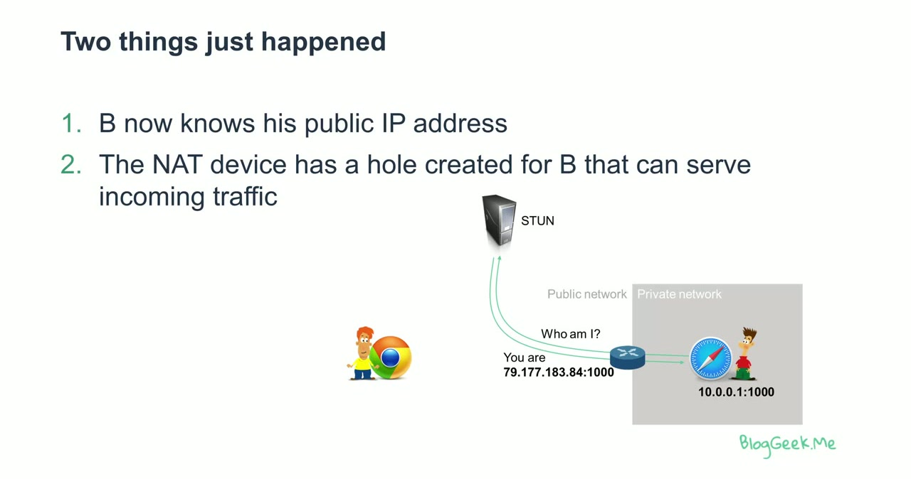
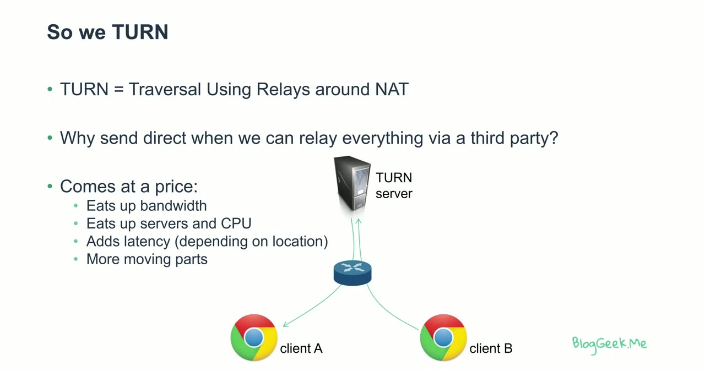
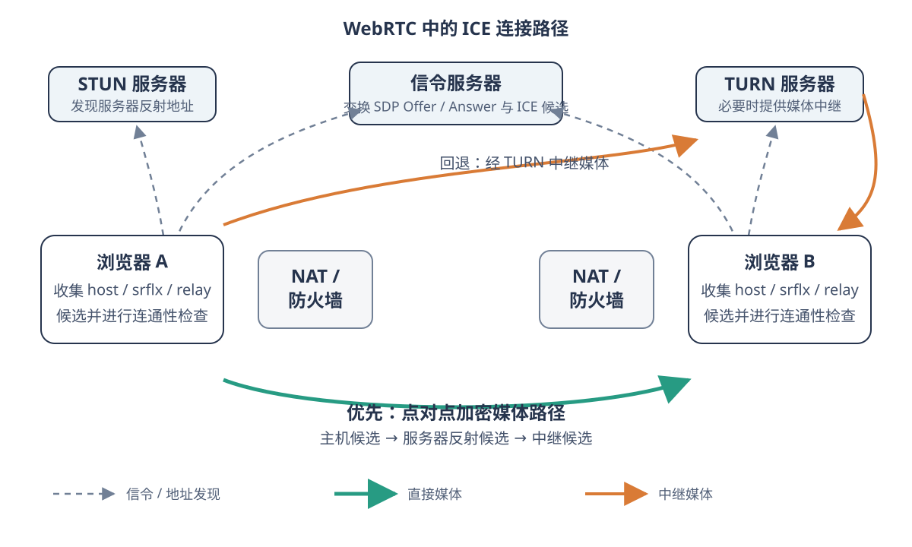
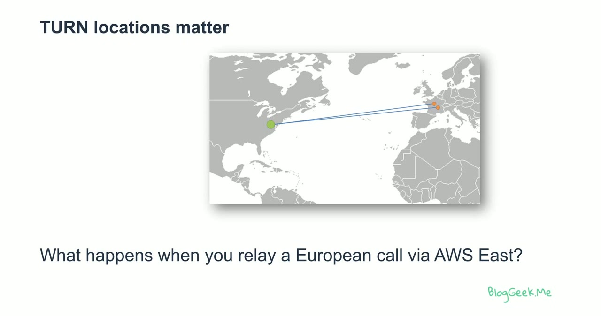

# 第 11 章 NAT 穿透

WebRTC 希望浏览器之间直接交换实时媒体，但真实网络并不是平坦、对称的：服务器通常有公网 IP 地址，用户设备却往往位于私有网络、网络地址转换（NAT）设备或防火墙之后。STUN、TURN 与 ICE 分别从地址发现、媒体中继和连接选择三个角度解决这一问题；Trickle ICE、ICE 重启、ICE Lite 与 ICE TCP 等机制，则进一步处理速度、重连和不同部署形态。

## 从服务器转发到浏览器直连

在客户端—服务器模式中，浏览器连接远程服务器，客户端请求数据，服务器返回响应。假设用户 A 要通过 Facebook Messenger 给用户 B 发消息，A 可以先把消息交给 Facebook 服务器，再由服务器转发给 B。文本消息较小，这种方式简单有效。

语音和视频则需要重新考虑路径：

- 媒体数据量远大于文本，全部经过服务器会增加服务器负载；
- 经过服务器会增加路径中的一跳，服务器位置又未必靠近双方，因此可能增加延迟。

理想目标是让 A 的浏览器直接向 B 的浏览器发送媒体。然而，B 通常只有私有 IP 地址，并受到 NAT 或防火墙保护。A 从公网主动发向 B 的数据可能被拦截，无法像访问公网服务器那样直接建立点对点通信。这正是 NAT 穿透要解决的问题。

## NAT 地址映射与 STUN

### NAT 如何改变外部可见地址

假设 B 在私有网络中的地址是 `10.0.0.1:1000`。B 向互联网发送请求时，NAT 设备会把私有来源地址转换为公网地址，例如 `79.177.183.84:1000`。对端服务器看到的不是 `10.0.0.1`，而是 NAT 转换后的公网来源。

当响应返回 NAT 设备时，NAT 再根据已经建立的地址关联，把目的地址翻译回 B 的私有地址并向内转发。客户端—服务器通信之所以能正常返回，正是因为 B 先向外发出了请求，NAT 因这次出站通信建立了映射关系。

### STUN 的发现过程

STUN 既指一种协议，也常用来指代 STUN 服务器。课程用“我是谁？”概括客户端向 STUN 服务器发起的请求，完整过程是：

1. B 向 STUN 服务器发送请求；
2. 请求经过 NAT，来源地址被转换为公网 IP 和端口；
3. STUN 服务器只能看到转换后的公网来源，而看不到 B 的私有地址；
4. STUN 服务器把它观察到的地址返回给 B；
5. B 将这个公网地址告诉 A，A 尝试向该地址发送数据；
6. 此前的出站请求还在 NAT 上形成了一种“针孔”或绑定，入站数据有可能沿该映射回到 B。

这个过程同时完成了两件事：客户端知道了外部可见地址，NAT 上也有了可能接收入站流量的映射。若映射适用于 A 发来的流量，双方就能直接通信。STUN 服务器只参与地址发现和协商，并不因此进入媒体路径。

*图：STUN 地址发现的两个结果（课程幻灯片，00:07:02）。*

### 对称 NAT 为什么会使 STUN 失效

不同 NAT 的映射和过滤行为并不相同。对于课程所述的对称 NAT，映射同时与来源和目的地址有关：

1. 客户端 A 向 STUN 服务器发送请求，得到一组外部 IP 和端口；
2. A 再向另一个 STUN 服务器或另一个客户端发送数据时，对端可能看到不同的 IP 或端口；
3. 如果客户端 B 向第一步得到的地址和端口发送数据，NAT 会检查 B 的来源地址；
4. B 的来源与 NAT 已知的 STUN 服务器来源不同，数据可能因此被拦截。

所以，STUN 返回一个公网地址并不等于任何对端都一定能使用该地址。它能降低直连成本，却不能保证在所有 NAT 和防火墙组合下成功。

## TURN：无法直连时中继媒体

TURN 是 Traversal Using Relays around NAT 的缩写，其核心不是返回客户端的公网地址，而是由服务器代替客户端转发数据：

1. 客户端 A 与 TURN 服务器建立绑定，为这次交互取得一个 TURN 地址；
2. 这个地址属于 TURN 服务器分配的中继地址，而不是 A 自身的公网映射地址；
3. A 把该中继地址提供给 B；
4. B 把数据发送到这个 TURN 地址；
5. TURN 服务器通过 A 事先建立的连接和针孔，把数据转发给 A。

双方的媒体因此都可经过第三方 TURN 服务器转发，从而绕开无法直接互通的问题，但代价也很明确：

- 中继消耗大量带宽，带宽成本高；
- 服务器和 CPU 资源被持续占用；
- 不再是点对点路径，会依据 TURN 的位置增加延迟；
- 系统增加了新的活动部件和故障点。

*图：TURN 中继路径及其带宽、计算和延迟成本（课程幻灯片，00:08:45）。*

### TURN 的三种传输方式

- **TURN over UDP**：性能表现最好，但 UDP 可能被网络封锁。
- **TURN over TCP**：并非实时媒体的理想选择，但在 UDP 不可用时更常能建立连接。
- **TURN over TLS**：WebRTC 媒体本身已经加密，再加一层 TLS 对媒体保密没有额外必要；它的价值在于覆盖更多网络环境。UDP 和 TCP 都失败时，TLS 路径仍可能可用。

实际通话中，有多少能直接点对点连接，有多少分别使用 TURN UDP、TCP 或 TLS，会随用户类型和他们所处的网络而变化，不能用单一比例概括所有服务。

### STUN 与 TURN 对照

| 对比项 | STUN | TURN |
|---|---|---|
| 核心用途 | 返回服务器观察到的外部 IP 和端口 | 分配中继地址并转发媒体 |
| 是否在媒体路径上 | 否，只在发现、协商阶段参与 | 是，媒体持续经过服务器 |
| 使用频率 | 几乎总会尝试 | 无法直连时才需要；课程给出的常见粗略估计为通话的 10%～20%，实际可高可低 |
| 后端成本 | 很低，网上也有免费服务器 | 高，主要消耗带宽、服务器和 CPU |
| 对媒体质量的影响 | 不直接影响媒体质量 | 可能因位置和整体网络架构影响延迟与质量 |
| 主要局限 | 简单便宜，但不保证穿透成功 | 几乎总能作为回退，却必须承担持续中继成本 |

因此，合理策略不是二选一，而是优先尝试低成本的直接路径，同时保留 TURN 作为必要时的回退。

## ICE：收集候选并选择可用路径

交互式连接建立（ICE）不是一台服务器，而是一套用于解决连接问题的协议或算法。它通过收集地址、交换候选和进行连通性检查，回答“在当前网络、当前时刻，连接对端的最佳方式是什么”。STUN 和 TURN 为 ICE 提供地址，ICE 负责尝试和选择。

*图：ICE 在直接路径与中继路径之间进行选择。*

### 三类候选地址

| 候选类型 | 获取方式 | 含义 |
|---|---|---|
| 主机候选（host） | 向操作系统查询本机地址 | 设备已知的本地 IP 和端口；一台设备可能有多个本地地址 |
| 服务器反射候选（server reflexive，SRFLX） | 向 STUN 服务器查询 | STUN 服务器观察到的客户端公网映射地址 |
| 中继候选（relay） | 由 TURN 服务器分配 | 为本次通话交互分配的 TURN 中继地址 |

例如，本机的 `10.0.0.1:4567` 可以作为主机候选；经 NAT 映射并由 STUN 发现的公网 IP 和端口是服务器反射候选；公共 TURN 服务器为本次会话分配的地址则是中继候选。若本机有多个本地 IP 地址，可以把这些主机候选都分享给对端。

课程特别指出，TURN 服务器也能承担 STUN 的作用。客户端向 TURN 请求绑定时，一方面获得中继地址，另一方面还能从服务器的响应中知道对方观察到的公网来源地址。因此，在这一过程中可以同时得到 TURN 中继候选和服务器反射候选。

### 候选交换与连通性检查

ICE 的基本步骤如下：

1. 双方分别收集主机、服务器反射和中继候选；
2. 通过会话描述协议（SDP）把 ICE 候选发送给对端；
3. 双方依据收到的候选组合尝试连接，既可以由本端连向对方，也可以让对方成功连到本端；
4. 一个或多个组合成功后，按偏好选择会话使用的路径。

偏好顺序是：

**主机候选优先于服务器反射候选，服务器反射候选优先于中继候选。**

如果主机候选成功，通常说明双方处于同一局域网，数据可以留在本地网络内。如果服务器反射候选成功，媒体可以直接沿 NAT 映射传输，STUN 服务器本身不转发媒体。前两者都失败时，再使用 TURN 中继路径。

课程的检查示例中，A 会从自己的主机地址向 B 提供的各种候选发起连接，也会通过自己的 TURN 服务器尝试连接 B 的候选；B 同样从自己的主机地址和中继路径检查 A 的地址。由此形成多组候选对，最终可能有一组或多组成功，再从中选取优先路径。

## Trickle ICE：边收集边检查

### 早期顺序流程的等待

ICE 在 WebRTC 之前已经存在。课程所描述的早期流程是：

1. A 先向 STUN/TURN 等服务器收集地址，并等待响应或超时；
2. 收齐后，A 才向 B 发送包含候选的提议；
3. B 收到提议后，再收集自己的地址并等待；
4. B 收集完成后发送应答；
5. 双方都取得对方地址后，才开始连通性检查并建立连接。

服务器故障、无法访问服务器以及等待超时都会拉长流程。课程指出，这可能让通话连接耗时达到 5 秒、10 秒甚至 30 秒。

### 并行流程

WebRTC 常使用 Trickle ICE，把候选收集、候选交换和连通性检查并行起来：

1. A 先发送包含本地地址的提议，同时向 STUN 和 TURN 服务器请求其他地址；
2. B 收到提议后，也立即用本地地址应答，同时收集自己的其他候选；
3. 任一方每得到一个新的服务器响应，就把它作为额外 ICE 候选立即发给对方；
4. B 一拿到 A 的本地地址就可以开始检查；A 收到首个应答、得到 B 的地址后也可以开始检查；
5. 新候选继续到达，检查继续进行；已有路径成功后，流程仍会继续，以便在完整过程中选择更合适的连接。

这样不必等所有地址收齐才开始行动，可以显著减少串行等待，更快建立可用连接。

## ICE 重启、强制 TURN 与凭据

### ICE 重启

通话过程中，用户可能移动位置、切换网络或改变 IP 地址，导致媒体中断。一种处理办法是关闭对等连接，再从零创建新连接；另一种办法是发起 ICE 重启。

ICE 重启通过信令交换 SDP 消息完成。课程给出的触发情形是：ICE 连接状态变为 `failed` 或 `disconnected`，并且连续几秒没有收发数据。相比重建整个对等连接，ICE 重启保留已有上下文，通常能用更少时间恢复连接。

### 强制只走 TURN

有些部署会主动忽略主机和服务器反射候选，强制使用中继，原因包括：

- 某些情况下希望简化并缩短连接建立过程；
- 希望强制选择特定网络路径，例如让中国用户与西方用户经过位于中国防火墙内侧、路径更合适的 TURN 服务器；
- 希望隐藏双方 IP 地址、增强隐私，课程以 WhatsApp 等服务为例。

在对等连接配置中把 ICE 传输策略设为 `relay`，即可让 WebRTC 忽略其他类型的路径。

### TURN 密码不能长期公开

TURN 带宽成本很高，服务提供者必须防止凭据被盗用。浏览器端的静态密码可能被他人通过网页检查工具和请求内容看到，再被拿去滥用 TURN 服务。因此，TURN 凭据应当是临时的或短期有效的，而不是把长期静态密码直接暴露在客户端。

## 回退顺序与部署形态

### 点对点连接

课程给出的基本优先级是：

1. **直接 UDP**：两个对端直接通信，可使用主机候选，也可使用 STUN 发现的服务器反射地址；
2. **TURN UDP 中继**：直接 UDP 不可用时，仍优先保留 UDP 媒体传输；
3. **TURN TCP 中继**：UDP 不可用时，用 TCP 换取更高可达性；
4. **TURN TLS 中继**：前面方式都失败时，利用 TLS 路径获得更广覆盖。

WebRTC 可以执行这些回退，但部署者要向它提供同一 TURN 服务对应的 UDP、TCP 和 TLS 地址。直接 TCP 也是另一条可选回退路径：直接 UDP 不通时，直接 TCP 可能成功；若直接 TCP 仍不可用，就可能只剩 TLS 中继。

### 连接公网媒体服务器

如果用户连接的是具有公网 IP 的媒体服务器，而不是另一个私有网络中的浏览器，所需地址会有所不同：

- 服务器的公网地址已经已知，客户端通常不再需要 STUN 来发现自己的公网地址；
- 客户端向媒体服务器主动发送数据，服务器可从该通信的来源返回响应，这一绑定过程与 STUN 场景中的出站映射有相似之处；
- 通常优先直接 UDP；若直接 UDP 不通，再使用 TURN TCP 或 TURN TLS；
- TURN UDP 通常不是必需，但有时可能提供更合适或未被封锁的地址，因此不能绝对排除。

### 媒体服务器支持 ICE TCP

若媒体服务器支持 ICE TCP，它会同时提供 UDP 和 TCP 候选。回退顺序可变为：

**直接 UDP → 直接 TCP 连接同一媒体服务器 → TURN TLS 中继。**

这时通常也不再需要 TURN TCP，但 TURN TLS 仍有保留价值。课程以 Jitsi Meet 和 Google Meet 当时的配置为例，说明支持 ICE TCP 的服务可以不配置 TURN UDP 或 TURN TCP。

## ICE Lite、ICE TCP 与 HTTP 代理

这些机制适用于不同部署。ICE 在早期 SIP 网络中已经常见，Trickle ICE 在 WebRTC 中很普遍，ICE 重启则主要用于恢复连接。

### ICE Lite

ICE Lite 适用于媒体服务器位于公网的情况。服务器采取一种简化实现：

1. 不收集自己的各种 ICE 候选，只提供公网 IP 地址；
2. 不主动进行完整的连通性检查；
3. 接收客户端收集并发来的候选，但由客户端承担检查工作；
4. 客户端尝试从自己的本地地址，或经一个、多个 TURN 中继，连接服务器公网地址，必要时使用 UDP、TCP 或 TLS 路径。

这种方式可能稍慢，却降低了媒体服务器实现 ICE 的复杂度。许多媒体服务器因此采用 ICE Lite，尤其是来自 SIP 体系的服务器，课程列举了 FreeSWITCH 和 Asterisk。

### ICE TCP

ICE TCP 让媒体服务器除 UDP 候选外，再提供一个 TCP 候选。客户端因此可以直接通过 TCP 连接媒体服务器，而不是只能借助 TURN TCP 中继。它减少了对 TURN TCP 的需求，但并不能取代所有 TLS 中继回退。课程指出，许多 WebRTC 媒体服务器已经支持 ICE TCP。

### HTTP 代理的影响

HTTP 代理由用户或浏览器环境决定，不完全受 WebRTC 应用控制。浏览器配置 HTTP 代理后，课程所述行为是：

- UDP 流量仍按原方式处理，不经过该 HTTP 代理；
- 信令以及 TCP 候选的流量可能经过 HTTP 代理；
- 若最终使用 TURN UDP，该媒体流量不因代理设置而改变路径；
- 若最终使用 TURN TCP，则路径会变为经过 HTTP 代理再到 TURN 服务器，而不是浏览器直接连接 TURN。

因此，实际诊断连接路径时，不能只看应用配置了哪些 ICE 地址，还要考虑浏览器代理环境。

## 生产部署

### TURN 中继通常是单侧的

“使用 TURN”不等于通话两端都以同一种传输协议接入 TURN。假设 A 因 UDP 被封锁而通过 TURN TCP 接入，B 与 TURN 服务器之间仍可能使用普通 UDP。也就是说，同一条中继路径的一侧是 TCP，另一侧可以是 UDP。分析性能和故障时应分别观察两侧，而不能把某一端的选择套到整条路径上。

### 服务器位置与调度

TURN 的位置直接影响质量。如果两位欧洲用户的媒体被迫绕经美国东部的 TURN 服务器，往返时间会升高，也更容易出现丢包和抖动。TURN 服务器以及媒体服务器都应尽量靠近所服务的用户。

*图：TURN 部署位置会改变媒体路径和延迟（课程幻灯片，00:34:34）。*

部署时需要连续回答几个问题：

1. **用户在哪里，数据中心在哪里？**应根据真实用户分布选择区域，而不是只看云厂商有多少机房。
2. **如何把用户分配到数据中心？**通常使用地理定位和 DNS 调度，例如 AWS Route 53，而不是在对等连接配置里堆放一长串 TURN 地址。
3. **优化目标是什么？**需要明确更看重延迟、丢包、比特率还是其他指标。
4. **每个数据中心如何扩展？**必须设计 TURN 的容量扩展和负载均衡。

课程为说明可选部署区域之多，列举了录制时 AWS 的 32 个区域、102 个可用区，以及 Google Cloud 的 39 个区域、118 个可用区。这些数字只是当时的规模示例，真正决定部署位置的仍是用户分布和服务目标。

### 自建与托管服务

课程给出三种获取 TURN 能力的途径：

- **使用 CPaaS 自带能力**：Twilio、Vonage、Daily 等 CPaaS 服务商通常已经提供 TURN，使用其平台时往往不必另建一套。
- **自行运行**：课程推荐的开源方案是 Coturn。
- **购买托管 TURN 服务**：若尚未使用 CPaaS，课程建议先使用付费托管服务，再决定是否迁移到自建；列举的提供方包括 Xirsys、Twilio 和 Cloudflare。

### 单播与 Anycast

大多数互联网寻址采用单播（unicast）：一个 IP 地址把流量导向特定目的端。Anycast 则让多个地理位置不同的设备或服务器共享同一个 IP 地址，路由器按照通常的目的地选择算法，把数据包导向离发送者较近的位置，典型依据是较少的 BGP 网络跳数。

Anycast 常用于 CDN 和 DNS，让内容或服务靠近用户；在传统电信和 VoIP 中并不常见。其路由本身没有会话状态概念，一条消息到达某处后，下一条消息可能被导向另一处，这与需要维持中继绑定的 TURN 存在天然张力。不过，课程也指出，较新的托管 TURN 服务已经开始采用这种方式。

课程录制时，Xirsys 和 Twilio 被归为覆盖约 7～9 个区域的传统托管选择，Twilio 依托 AWS 数据中心；Cloudflare 则以 250 多个城市和使用 Anycast 调度作为特点，而不是依靠 Route 53 或 DNS 地理定位。这些属于当时的产品观察，不应视为固定不变的覆盖数据。

### 课程给出的部署检查清单

- **不要因为当前测试能直连就省略 TURN。**“现在对我有效”不能覆盖用户将来的各种网络。
- **不要依赖免费的 TURN 服务。**持续中继带宽昂贵，免费方案难以提供所需质量。
- **不要堆放过多 TURN 或 STUN 地址。**课程建议所配置的 STUN/ICE 服务器列表不要超过 4 个，也不要用冗长列表代替 DNS 调度。
- **不要把 TURN 端口范围限制得过小。**不应按眼前几路通话只开放极少端口；课程建议从第一天就预留约 20,000 个端口的量级，避免扩张后难以调整。
- **让 TURN 靠近用户。**远端中继会放大延迟、丢包和抖动。
- **同时支持 UDP、TCP 和 TLS。**尤其不要漏掉 TLS 回退。
- **重视 443 端口，也可兼顾 80 端口。**课程建议主要把服务放在 443，而不是只依赖 TURN 默认端口，以获得更好的连通性。
- **设计冗余与负载均衡。**两者都是生产部署所必需的。
- **按地理位置优化延迟。**用调度把用户分配到合适的附近节点。
- **保留日志与分析数据。**没有可观测数据，就无法判断中继质量、容量和故障原因。

## 小结

NAT 使出站请求形成的地址映射成为浏览器直连的基础。STUN 帮助客户端发现服务器反射地址，成本低且不进入媒体路径，但不能穿透所有 NAT；TURN 通过服务器中继提高可达性，却持续消耗带宽和计算资源，并可能增加延迟。ICE 把主机、服务器反射和中继候选组织起来，通过 SDP 交换和连通性检查选择路径，优先级通常是主机、服务器反射、中继。Trickle ICE 用并行收集和检查缩短建连时间，ICE 重启负责网络变化后的恢复，ICE Lite 与 ICE TCP 则简化或扩展媒体服务器侧的连接能力。

在生产环境中，关键不是寻找一条永远可用的固定路径，而是准备直接 UDP、TURN UDP、TURN TCP、TURN TLS 以及适用时的直接 TCP 回退，并配合短期凭据、合理端口范围、DNS 地理调度、就近部署、冗余、负载均衡和可观测性，让 WebRTC 在不对称的真实网络中仍能建立连接。
