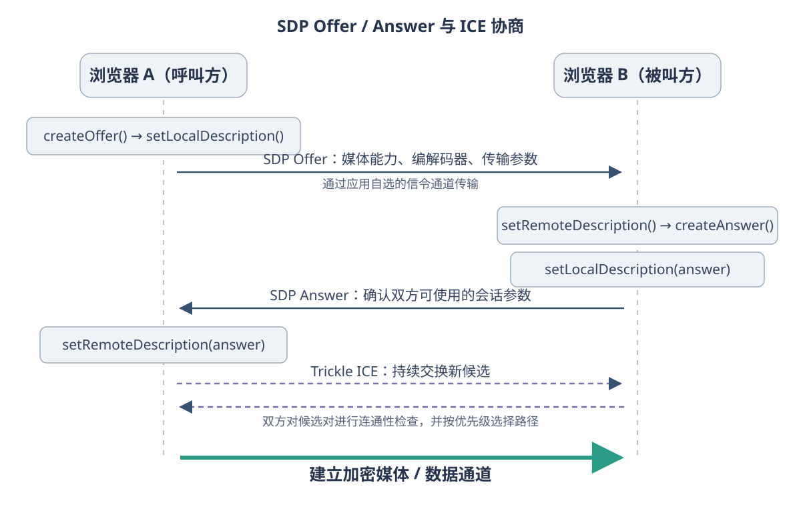
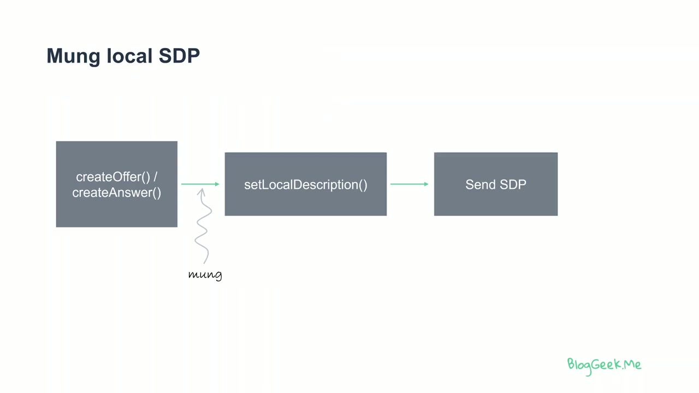
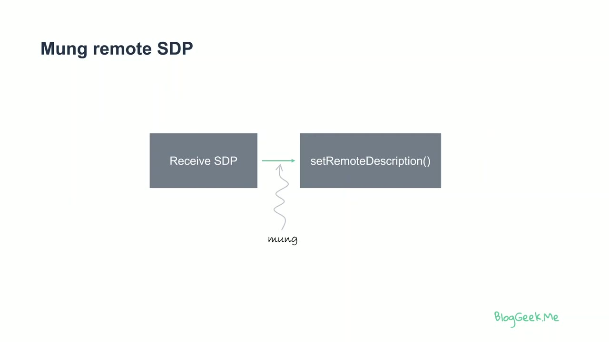
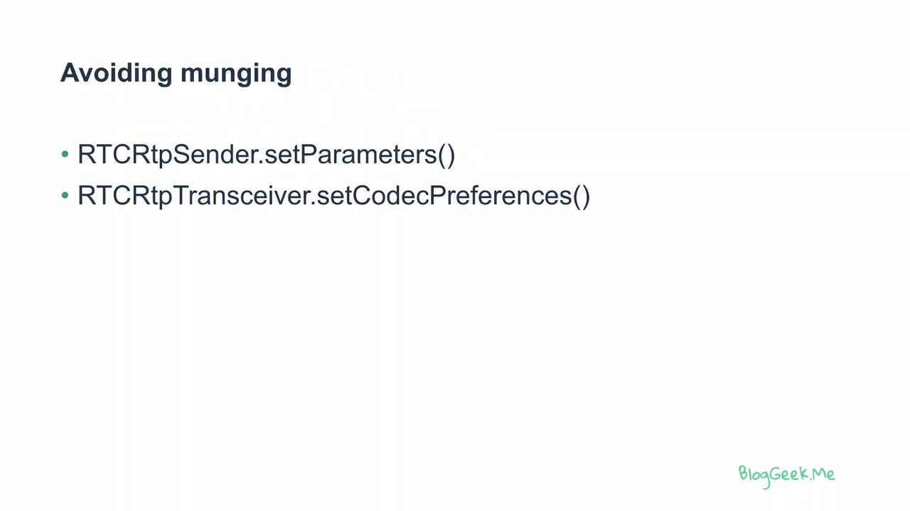

# 第 20 章 SDP

WebRTC 使用会话描述协议（SDP，Session Description Protocol）表达会话与媒体配置，但 SDP 的文本格式并不适合作为现代 JavaScript 应用的直接操作对象。本章先说明 SDP 描述了什么以及如何完成 offer/answer 交换，再讨论修改 SDP（SDP munging）的用途与风险，最后解释 WebRTC 沿用 SDP 的历史原因。

## SDP 描述会话与媒体属性

SDP 是 IETF 标准，常用于 SIP 和 IMS，也被 WebRTC 采用。在一次通话中，它需要表达一方希望做什么、具备哪些能力，以及双方应当使用哪些媒体参数。例如：

- 进行视频通话还是仅进行语音通话；
- 是群组会话还是一对一会话；
- 使用哪些编解码器；
- 对端可以连接哪些 IP 地址；
- 媒体如何发送、接收和复用。

这些信息都属于会话建立时需要交换的媒体属性。SDP 负责描述它们，却不负责把描述发送到远端；发送 SDP 是应用信令的任务。

## SDP 的文本结构

SDP 由多行文本组成，每一行基本采用“一个字符加值”的形式，可以把它理解为一种行式键值结构：

```text
字符=值
```

它与 JSON 不同，没有一个面向 JavaScript 对象的天然层级表示。课程示例中的 SDP 可分成三个逻辑层次：

1. **会话描述**：说明整份 SDP 所描述的会话。
2. **时间描述**：SDP 字段体系中还包含时间相关的描述。
3. **媒体描述**：针对需要发送或接收的媒体分别给出配置。

并不是所有字段都会在每一段示例中同时出现，但阅读 SDP 时必须先分清字段作用于整个会话，还是只作用于某一项媒体。

### 会话级与媒体级属性

课程重点提到以下几类行：

| 行类型 | 含义与阅读重点 |
| --- | --- |
| `v=` | 位于示例顶部的会话描述部分 |
| `a=` | 属性行；既可描述整个会话，也可描述某个媒体部分 |
| `m=` | 媒体行，开始一段媒体描述；示例中的媒体类型包括音频和视频 |

`m=` 后还带有与该媒体有关的参数，例如可用的负载类型和传输相关信息。它后面的属性行继续补充媒体配置，包括：

- 编解码器类型及其部分配置；
- 是否同时发送和接收媒体；
- 是否使用 RTCP 复用，即让 RTCP 与 RTP 一起复用；
- 传输与媒体能力所需的其他属性。

会话级属性还可以表达 BUNDLE：课程示例把编号为 0 和 1 的两段媒体描述打包到同一个 RTP 套接字上。由此可见，SDP 不只是“音频或视频加编解码器名称”，它还描述媒体之间的组织和传输关系。

### 为什么不能只背一份字段表

SDP 的字段类型和属性很多，主 RFC 并没有独立解释所有细节，一些内容还要结合其他 RFC。WebRTC 对字段的使用又与 SIP 中的实践略有差别，哪些内容必需、哪些内容可选，不能简单地从一种环境照搬到另一种环境。

在 WebRTC 语境下，还应结合 JSEP 和 offer/answer 模型理解 SDP。只认识个别 `m=` 或 `a=` 行，并不等于掌握了整个协商过程。

## WebRTC 的 offer/answer 流程

会话开始时，双方通过 SDP offer 和 SDP answer 交换描述。设 A 为发起方、B 为接收方，流程如下。



*图：SDP 描述交换与 ICE 候选收集、检查可以并行推进。*

### 1. A 创建 offer

A 调用 WebRTC 的 `createOffer()`，浏览器生成一份 SDP offer。A 将这份描述通过 `setLocalDescription()` 设置为自己的本地描述。

### 2. 应用把 offer 发送给 B

offer 的网络发送不属于 WebRTC 本身。应用可以选择合适的传输和信令协议，例如：

- SIP over WebSocket；
- 其他标准或既有协议；
- 自建专有协议，常见做法是承载在 WebSocket 上。

WebRTC 只生成并消费描述，不会替应用决定用户定位、消息路由或信令格式。

### 3. B 接受 offer 并创建 answer

B 收到 offer 后，如果愿意响应，就把远端 offer 通过 `setRemoteDescription()` 设置进去，再调用 `createAnswer()` 生成 SDP answer，并通过 `setLocalDescription()` 设置为本地描述。

### 4. B 返回 answer，A 接受 answer

B 的应用把 answer 经信令通道发回 A。A 收到后调用 `setRemoteDescription()`，将 B 的 answer 设置为远端描述。

到这里，双方都保存了自己的本地 SDP 和对端的远端 SDP，WebRTC 才能据此继续建立连接。所谓“接受 offer”或“接受 answer”，在 API 层面并不是单独的一个接受动作，而是双方分别在正确时机设置本地描述和远端描述。

## 为什么有人修改 SDP

浏览器生成的默认 SDP 不一定能满足应用的所有需求。有时，应用希望对媒体行为施加更多控制，而当时的 WebRTC API 没有提供直接入口，于是开发者会在 SDP 进入浏览器或发往网络之前修改文本。这种做法通常称为 **SDP munging**。

需要修改 SDP，并不意味着它是一种稳定、推荐的通用控制接口。它之所以长期存在，恰恰是因为开发者想获得默认描述之外的能力，而可用的正式 API 曾相对有限。

## SDP munging 的问题

### 文本难以可靠地解析和操作

SDP 虽然是文本，却不是 JSON。用 JavaScript 手工解析、修改和重新拼接 SDP，通常会产生冗长而脆弱的代码。课程录制时，没有一个完整、统一的 JavaScript 包装 API 能代替所有此类操作，开发者往往只能阅读 RFC，再通过实验判断某项修改是否有效。

### 浏览器不一定会采用修改结果

调用 `createOffer()` 后得到的是浏览器生成的 SDP。即使应用修改其中某些字段，再把结果交给 `setLocalDescription()`，也不能据此推断浏览器一定会尊重所有修改：有些字段可能被主动读取，有些则可能不被关注。

“文本已经改变”与“浏览器行为已经改变”不是同一件事。

### 跨浏览器和跨设备行为不一致

SDP 有标准文本格式，不代表所有实现都会以完全相同的方式解释它。不同浏览器或设备可能实现不同部分，也可能对某些修改作出不同反应。因此，依赖 SDP munging 的代码需要承担额外的互通性风险，而且浏览器厂商将来可能禁止某些修改方式。

## 本地 SDP 与远端 SDP 的修改位置

课程描述了两种典型的修改位置。

### 修改本地描述

1. 调用 `createOffer()` 或 `createAnswer()`，得到浏览器生成的 SDP。
2. 在交给浏览器和发送到网络之前修改这份 SDP。
3. 将修改后的 SDP 传给 `setLocalDescription()`。
4. 将相应的描述通过信令发送给远端。



*图：本地 SDP 的修改位置（课程幻灯片，00:10:01）。*

这样做的实质，是让浏览器和远端看到一份与最初生成结果不同的描述，以尝试改变后续行为。

### 修改远端描述

收到对端发来的 offer 或 answer 后，应用也可以在调用 `setRemoteDescription()` 之前修改 SDP，再把修改后的文本交给浏览器。其目的仍是影响浏览器对远端描述的处理。



*图：远端 SDP 的修改位置（课程幻灯片，00:10:31）。*

这两个位置都说明 SDP munging 发生在 WebRTC API 与信令文本的交界处，而不是网络传输本身的一种特殊机制。

## 优先使用正式 API

如果正式 API 已经能完成目标，应优先使用 API，而不是修改 SDP。课程提到的选择包括 `setParameters()` 和 `setCodecPreferences()`。

这些 API 在课程录制时仍未必覆盖所有浏览器，相关能力也在持续完善，但在它们可用的场景中，通过 API 设置参数或编解码器偏好通常更清晰，也更有机会保持向后兼容。相反，依赖文本修改会把应用绑定到浏览器当前对若干字段的内部处理细节。



*图：课程给出的两类正式控制 API（课程幻灯片，00:11:07）。*

因此，实际判断顺序应当是：

1. 先确认默认 SDP 是否已经满足需求。
2. 再检查正式 WebRTC API 是否提供对应控制。
3. 只有在确有必要且理解互通性代价时，才考虑 SDP munging，并充分验证各目标浏览器和设备。

## WebRTC 为什么采用 SDP

WebRTC 使用 SDP 并非只因为 SDP 是通用的会话描述格式，还与其媒体引擎的历史有关。

Google 收购了 Global IP Sound（GIPS），后者的语音和视频技术成为 WebRTC 媒体引擎的基础。GIPS 过去提供 Voice Engine，并主要面向 SIP 客户销售可集成到应用中的媒体引擎。

为了让这类集成更顺畅，GIPS 没有只为引擎设计一组细粒度控制 API，而是让引擎 API 直接接收 SDP：调用方把 SDP 交给语音引擎，引擎解析描述并据此完成配置。WebRTC 在早期采用这套基础时，也沿用了以 SDP 作为 API 输入的做法。

这一选择节省了设计时间，避免了重新争论一整套 API 和网络表示层。如果没有 SDP，就需要有人定义各项控制 API，还要决定这些信息怎样在网络上传送。

ORTC（Object RTC）曾作为与 WebRTC 平行的一种提议，尝试以不同方式组织这些能力。按课程所述，ORTC 最终没有作为独立路线被采用，但其中不少概念和 API 被引入 WebRTC，`setCodecPreferences()` 就是例子。这也解释了为什么现代 WebRTC 会逐渐提供更多正式控制入口，从而减少直接修改 SDP 的必要。

## 小结

SDP 用行式文本描述会话、媒体和传输属性，是 WebRTC offer/answer 协商的核心数据。A 创建并设置本地 offer，应用通过信令把它交给 B；B 设置远端 offer、创建并设置本地 answer，再把 answer 返回给 A，由 A 设置为远端描述。SDP 的传递由应用负责，不属于 WebRTC 自动完成的范围。

直接修改 SDP 可以绕过默认描述的一部分限制，却伴随解析困难、浏览器不一定采用修改、跨实现差异和未来兼容性风险。能够使用 `setParameters()`、`setCodecPreferences()` 等正式 API 时，应避免 SDP munging。理解这套机制的历史来源，有助于解释它为何存在，但历史原因并不会降低工程上对清晰 API 和互通性的要求。
