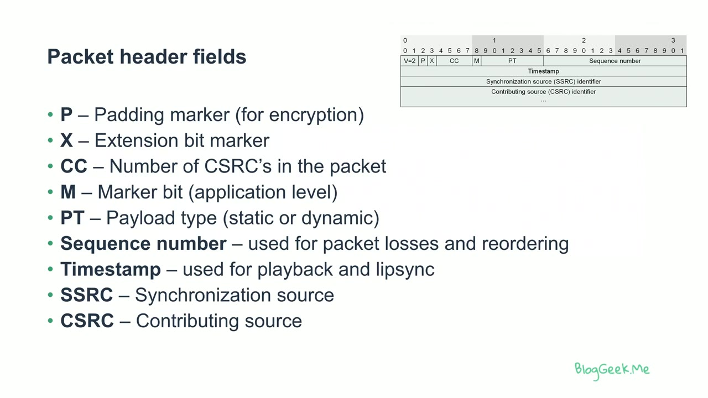

# 第 35 章 RTP 与 RTCP

音视频编码完成后，还需要解决三个彼此关联的问题：怎样把媒体报文实时送到对端，怎样了解发送与接收的状况，以及怎样保护媒体内容。RTP 负责媒体传输，RTCP 负责报告与控制，SRTP 和 SRTCP 则为它们提供安全保护。WebRTC 不直接以明文方式使用 RTP、RTCP，而是强制使用安全的媒体传输，不能选择发送未加密、未受保护的媒体。

## 为什么实时媒体通常基于 UDP

网络上的传输基础主要是 UDP 或 TCP。二者都能传递数据，但它们提供的抽象和保证不同。

| 特性 | UDP | TCP |
| --- | --- | --- |
| 数据边界 | 面向消息，适合发送媒体帧和媒体包 | 面向字节流，把数据视为一条连续流 |
| 可靠性 | 不保证送达 | 保证数据按序送达，否则连接会断开 |
| 重传 | 不自动重传 | 必要时自动重传 |
| 连接方式 | 无连接 | 面向连接 |
| 内建机制 | 除发送数据报外，基本不提供其他保障 | 提供段编号、重排序、确认、重传、可靠性和拥塞控制 |

对实时媒体来说，UDP 的消息边界很自然，因为编码器本来就产生一帧帧、一个个数据包。TCP 的全面可靠性反而可能成为负担：如果一个媒体包重传到对端时已经错过播放时间，它就不会再有实际价值，却仍然占用了网络资源。

连接或无连接本身不是这里的核心矛盾。真正的问题是，UDP 几乎什么也不保证，而 TCP 保证得太多，并且这些保证并非都符合实时通信的需要。

### TCP 的可靠性为何会形成负担

TCP 不理解所承载的内容，却默认所有数据都必须收到。实时通信则把决定权交给最了解媒体语义的应用程序：某些迟到帧应当放弃，某些关键数据可能值得重传，某些场景则更适合使用冗余或错误隐藏。

主要冲突体现在以下方面：

- **自动重传可能太晚。** 实时媒体不想无条件重传。等到旧报文终于到达时，接收端可能已经无法再播放它。
- **队头阻塞会延迟后续数据。** TCP 在等待缺失数据时，后续数据也不能按应用需要直接交付。实时通信不能始终这样等待，有时必须丢弃正在等待的旧帧，继续处理后续媒体。
- **丢包可能形成恶性循环。** 媒体经过 TCP 传输时，丢包触发重传，重传增加网络拥塞，拥塞又可能造成更多丢包。原本想修复一个问题，却可能扩大通话质量问题。
- **拥塞控制目标不同。** TCP 往往在遇到拥塞后降低现有发送速率；实时通信还需要进行带宽估计，先估计网络可用带宽，再据此调整媒体码率。二者相关，但并不完全相同。
- **有序交付不等于完整的媒体缓冲。** 实时接收端也会通过抖动缓冲区重排报文，但它还承担其他媒体处理任务，并且不能为了绝对有序而无限等待。

实时通信并非完全不要反馈或重传。它可以使用否定确认（NACK）、重传请求、前向纠错和冗余编码等技术，关键是这些机制具有**选择性**：由应用决定何时使用、对什么数据使用以及使用多久，而不是对所有字节一律追求可靠交付。

因此，本章讨论的 RTP 媒体路径建立在 UDP 之上。但 UDP 本身又不足以完成实时媒体传输，还需要 RTP 提供接收端所需的媒体信息。

## UDP 网络上会出现哪些问题

### 丢包与重复

假设发送端依次发送消息 1、2、3：消息 1 成功到达，消息 2 在网络中丢失，消息 1 又被重复投递一次，随后消息 3 到达。接收端看到的序列就可能变成 1、1、3。

接收端需要知道：消息 2 缺失，消息 1 收到了两次。没有额外信息，UDP 本身不会告诉应用这些事实。

### 乱序

不同报文可能经过不同的网络路径。发送顺序为 1、2、3，到达顺序却可能是 2、1、3。接收端必须识别这种乱序，并在合适的时候恢复为原来的媒体顺序。

### 抖动

发送端可能严格按固定节奏发包，例如每 20 ms 发送一个音频包；接收端却不一定以相同节奏收到。某个包延迟后，后续几个包又可能在很短时间内集中到达，使包与包之间的到达间隔忽长忽短。这种发送节奏与到达节奏之间的变化称为**抖动**。

加载网页或图片时，这种间隔变化通常不重要；播放音频或视频时，它却会导致声音忽快忽慢、停顿、卡顿或画面冻结。接收端希望尽可能恢复媒体最初录制时的连续节奏，而不是报文一到就立即播放。

## RTP、RTCP 与安全协议的分工

| 技术 | 主要回答的问题 |
| --- | --- |
| RTP | 如何在网络上实时发送和接收媒体报文 |
| RTCP | 如何报告已发送、已接收媒体的进展、统计与状态 |
| SRTP / SRTCP | 如何安全地传输 RTP / RTCP，保护媒体隐私，使媒体内容只对预期通信方可见 |

RTP 携带媒体，RTCP 伴随 RTP 提供反馈。反馈可以帮助发送端决定是否重传、降低码率或采取其他措施，但 RTCP 本身并不会把 UDP 变成可靠传输协议。

## RTP 的核心信息：序列号与时间戳

### 用序列号识别缺失、重复与乱序

RTP 为发送的数据包分配序列号，每发送一个包，序列号加一。接收端据此可以：

- **发现潜在缺失**：若已经收到 3 号包而尚未收到 2 号包，就知道 2 号包目前缺失。它也可能只是迟到，不能仅凭到达先后立即断定永久丢失。
- **去除重复**：同一个序列号的包再次到达时，可以忽略重复副本。
- **恢复顺序**：把先到的后续包暂存在缓冲区中，等待较早的包。例如，在 2 号包到达之前先保存 3、4 号包，再按正确顺序交给后续播放流程。

承担这种等待和重排工作的缓冲区通常称为**抖动缓冲区**。不过等待必须有边界：过旧的帧如果已经错过播放时机，继续等待反而会影响实时性。

### 用时间戳恢复播放节奏并同步媒体

序列号只能表达包的先后，不能独立解决媒体播放节奏。RTP 还携带时间戳，用来描述媒体创建或采样的时间。接收端利用它安排解码和播放，而不是把网络到达时间当成媒体时间。

时间戳也不能完全替代序列号。仅看相邻时间戳，接收端未必知道下一个包与上一个包之间应当相差多少，也不知道采集或播放设备采用什么发送节奏。因此，序列号和时间戳分别承担不同职责，需要同时存在。

时间戳还与跨媒体同步有关。音频和视频以不同流发送，到达时间不会完全一致，但播放时必须保持口型同步。除了排序与定时，RTP 体系还要支持识别音频和视频、错误隐藏、码率控制以及服务质量反馈。

## RTP 报文结构

一个 RTP 报文可理解为三个连续部分：

```text
RTP 头部 | RTP 载荷头部（如适用） | 编码后的媒体载荷
```

### RTP 头部

RTP 基础头部通常带来约 12 字节开销，存在贡献源列表或扩展时会更大。课程希望尽量压低这部分开销，把有限的网络资源留给媒体本身。头部包含序列号、时间戳以及描述媒体来源和载荷类型的信息。

主要字段如下：

| 字段 | 作用 |
| --- | --- |
| 版本（V）与填充标记（P） | 描述 RTP 版本和填充状态；课程在 SRTP 部分进一步说明填充与加密报文的关系。 |
| 扩展位（X） | 表示存在 RTP 头部扩展，用扩展机制为 RTP 增加功能。WebRTC 大量使用头部扩展，本章不展开各扩展协议。 |
| CSRC 计数（CC） | 表示本报文有多少个贡献源，可以为零，也可以大于零。 |
| 标记位（M） | 由具体载荷格式和应用解释，协助识别媒体数据边界或其他事件。 |
| 载荷类型（PT） | 表明所传内容是哪类音频或视频、使用什么编解码器及通道格式；会话开始时通过会话描述协议（SDP）协商。 |
| 序列号 | 16 位编号，用于识别缺失、重复和乱序；取值用满后回绕，再从零开始。 |
| 时间戳 | 表示媒体在编码之前的创建或采样时间，供接收端安排解码、播放与媒体同步。 |
| 同步源标识符（SSRC） | 32 位标识符，表示该 RTP 流的主要同步源。它可能直接对应摄像头或麦克风，也可能对应 MCU 混合多个来源后形成的流。 |
| 贡献源标识符（CSRC）列表 | 当 CC 非零时列出生成该媒体各贡献来源的 32 位标识符。大型通话和媒体服务器可借此了解报文内容来自哪些源。 |

SSRC 与 CSRC 的区别在于：SSRC 标识当前同步源，CSRC 则描述对当前媒体作出贡献的来源。例如，MCU 输出的混合流可以有一个代表混合流的 SSRC，同时通过贡献源信息表明混合了哪些输入。



*图：RTP 头部字段及其用途（课程幻灯片，00:15:03）。*

### RTP 载荷头部与媒体载荷

RTP 头部之后是载荷头部和实际媒体数据。不同编码格式有不同的 RTP 载荷封装规范：Opus、VP8、VP9、H.264 等格式可以定义各自的载荷头部结构，某些格式也可能不需要额外的载荷头部。

载荷头部帮助接收端解释和解码真正的数据单元。换言之，RTP 头部负责实时传输所需的通用信息，编码格式相关的载荷头部负责说明“这一段编码媒体应当怎样组装和解释”，最后才是编码后的媒体本身。

## 音频与视频如何装入 RTP 报文

### 音频：通常一帧对应一个包

麦克风产生音频帧，音频编码器将其编码为准备发送的数据。课程所讨论的大多数音频编解码器通常每 20 ms 产生一帧。RTP 为这些帧加上 RTP 头部和适用的载荷头部，形成报文；这里通常每个报文承载一帧，并大致按照帧产生的节奏发送到网络。

### 视频：一帧可能拆成多个包

摄像头把图像帧交给视频编码器，编码后的帧大小并不固定：

- I 帧通常包含较多数据；
- P 帧与前面的帧差异较小时，编码结果可能短得多；
- 帧大小还会受到其他编码因素影响。

视频与音频的生成节奏也不同。若帧率为 30 fps，大约每 33 ms 就有一帧需要编码和发送。

一个编码视频帧可能太大，无法放入单个 UDP 数据报。RTP 封装需要把这样的帧拆到多个报文中，为各部分添加相应的 RTP 头部和载荷头部。较小的帧也许一个包就能装下，较大的帧则跨越多个包。接收端再依据这些封装信息恢复编码帧。

因此，RTP 的任务不仅是增加序列号和时间戳，还包括把大于单条网络消息承载能力的媒体帧拆分到多个报文中。

## RTCP：获得接收反馈与通话状态

只发送 RTP，发送端并不能确切知道对端收到了哪些报文，也不知道数据发出以后接收端经历了什么。RTCP 用来补足这部分反馈。

### RTCP 的基本职责与开销

课程将 RTCP 的主要功能概括为三方面：

1. **收集并报告统计信息。** 发送方和接收方都参与，监测 RTP 的工作状况并报告结果。
2. **提供源描述信息，包括 CNAME。** CNAME 用于把 RTP 流关联到稳定的逻辑媒体源，可辅助音视频同步，并在 SSRC 变化后维持源身份关联。本章不展开 RTCP SDES 的完整格式。
3. **控制报告所占带宽。** 媒体报告和控制不能挤占过多媒体空间，这与尽量减小 RTP 头部的目标一致。

RTCP 流量通常限制为 RTP 可用比特率的约 5%。这是协议默认值，可以配置。后来 RTCP 还承担更多控制功能，例如发送 AVPF 相关控制消息；这些扩展机制不在本章展开。

### 发送方报告（SR）

RTCP 有多种报文类型，最常见、发送最频繁的两类是发送方报告（Sender Report，SR）和接收方报告（Receiver Report，RR）。

SR 的报文类型值为 **200**。课程展示的主要字段包括：

| 字段或信息 | 含义 |
| --- | --- |
| 版本与填充位 | 与 RTP 报文类似，描述协议版本和填充状态。 |
| 报文类型 200 | 明确表示这是发送方报告。 |
| 长度 | 表示该报文或报告的长度。 |
| 发送者 SSRC | 标识生成这些数据和报告的发送源。 |
| 报告时间戳与 RTP 时间戳 | 提供报告自身的时间信息，以及与 RTP 媒体时间相关的信息。 |
| 已发送数据包数 | 告诉对端在相应时间范围内发送了多少个 RTP 包。 |
| 已发送字节数 | 告诉对端发送了多少媒体字节。 |

发送计数为判断传输情况提供基线：把发送端声称发出的数量与接收端实际观察到的数据结合起来，才能判断是否有包缺失、缺失规模如何。SR 还包含其他信息，课程没有逐项展开。

### 接收方报告（RR）

RR 的报文类型值为 **201**，由接收媒体的一端发出。课程列出的主要反馈包括：

| 反馈信息 | 用途 |
| --- | --- |
| 丢包比例（fraction lost） | 描述相应统计区间内的丢包情况。 |
| 累计丢包总数 | 描述到目前为止累计丢失的包数。 |
| 已收到的最高序列号 | 让发送端知道接收端观察到了哪个序列范围。 |
| 到达间隔抖动 | 报告接收端根据这一期间的到达情况累计、计算出的抖动。 |
| 上一次发送方报告（LSR） | 指明接收端最近参考的 SR。 |
| 自上一次发送方报告以来的延迟（DLSR） | 表示收到该 SR 到发出当前报告之间的时间。 |

LSR 与 DLSR 帮助双方理解报告涉及的时间范围，并可用于计算往返时间（RTT）。SR 和 RR 在整个会话期间持续发送，使通信双方能够不断了解通话状态，而不是只在建立连接时检查一次。

### 从报告走向质量控制

可以用一个发送者向多个接收者发送相同媒体的例子理解反馈闭环：

1. 发送者持续发送 RTP 媒体包，同时发送携带 SR 的 RTCP 报文，说明自己实际发送了多少数据。
2. 各接收者发送携带 RR 的 RTCP 报文，说明自己实际收到的数据、丢包、抖动以及与 SR 有关的时间信息。
3. 发送者结合这些报告判断下一步动作：是否有选择地重传、是否降低码率，或者采取其他调整。

这个闭环体现了实时媒体质量控制与 TCP 可靠交付的差别。RTCP 报告不会要求所有包自动重传；应用需要结合媒体的时效性作出选择。丢失且已经过时的帧可能不值得补发，继续无条件重传反而可能加重拥塞。接收端还可以使用错误隐藏，发送端和接收端也可按场景采用 NACK、重传请求、前向纠错或冗余编码。

因此，传输质量控制需要把多类信息组合起来：RTP 序列号帮助发现缺失与乱序，时间戳和抖动缓冲区帮助恢复播放节奏，RTCP 报告提供丢包、抖动和往返时间等反馈，带宽估计帮助调整发送码率。具体策略始终由应用根据媒体内容和时间约束决定。

## 媒体复用：减少 UDP 连接

### 早期的四个独立连接

早期一种直接的做法是，为一次简单的视频通话建立四个独立 UDP 连接：

- 音频 RTP；
- 音频 RTCP；
- 视频 RTP；
- 视频 RTCP。

系统需要分别打开、维护和验证四个连接。端口和 SDP 协商帮助识别各连接的用途，SSRC 标识媒体来源，时间戳则可用于音频和视频 RTP 流之间的同步。

### 多连接带来的问题

**资源消耗。** 对现代设备来说，多几个套接字似乎无关紧要，但早期智能手机上，一个 UDP 套接字和四个 UDP 套接字的差别很重要。服务器扩展到 10,000 路通话时，则是维护 10,000 个与 40,000 个套接字的差别。

**建立时间与信令。** 如果每个连接都单独进行交互式连接建立（ICE），就要分别处理 TURN 分配、UDP/TCP/TLS 候选、公共地址发现、地址交换以及连接协商。更多连接意味着更多信令、更长建立过程和额外网络负担。

**连接成功率。** 需要独立建立成功的连接越多，整体失败的机会也越多。服务器和多人通话中用户数量较大时，这个问题尤其突出。

因此，WebRTC 希望减少连接数，既优化资源使用，也提高通话成功建立的可能性。

### BUNDLE：音频与视频共用 RTP 传输

第一种合并方式是把音频和视频放在同一个 RTP 传输连接上，也就是使用 **BUNDLE**。合并以后仍需要区分两路媒体：音频和视频可使用不同的载荷类型，同时通过各自的 SSRC 区分媒体源。

SDP 使用 `a=group:BUNDLE` 表示并协商这种捆绑能力。

### RTCP 复用：RTP 与 RTCP 共用连接

第二种方式称为 **RTCP 复用（RTCP mux）**。发送方在同一个套接字上，把 RTP 与 RTCP 报文发往相同的 UDP 目标 IP 地址和端口：大多数时候发送 RTP，间或发送 RTCP。

SDP 使用 `a=rtcp-mux` 表示这种能力。复用时通过报文第二字节所属区间区分 RTP 与 RTCP：RTCP 类型位于 192～223，例如 SR 为 200、RR 为 201；RTP 动态载荷类型 96～127 可用，静态载荷类型也可按协商使用，但 64～95 必须避开，以免与 RTCP 类型空间冲突。

### WebRTC 中的组合使用

WebRTC 几乎总是同时采用 BUNDLE 和 RTCP 复用，使音频、视频的 RTP 与 RTCP 都能走同一个连接。只有在互连的媒体服务器不支持这些能力时，才可能需要拆回多个音频/视频、RTP/RTCP 连接。

## SRTP：为 RTP 增加安全保护

SRTP 即安全实时传输协议（Secure RTP），可以理解为 RTP 加上安全保护。它是 WebRTC 的强制要求，应用不能自行决定关闭媒体安全、发送不加密且不受保护的媒体。

这种要求与互联网整体转向安全通信的方向一致：网站从 HTTP 转向 HTTPS，WebRTC 则在设计现代协议时就把安全作为基础能力。浏览器应用无法控制浏览器所处的网络，而音视频又属于敏感数据，因此不能假定网络路径上的其他节点都值得信赖。

### 加密、认证与完整性

SRTP 提供三项核心能力：

- **加密（encryption）**：报文内容经过加密，未持有相应密钥、无法解密的人即使看到报文，也不能理解媒体内容。
- **认证（authentication）**：接收端能够验证数据确实来自预期发送方，而不是其他人冒名发送。
- **完整性（integrity）**：能够检查消息在传输途中是否被修改，确认收到的数据与发送的数据一致。

课程指出，SRTP 通常使用 AES 和 HMAC-SHA1，具体变体取决于实际协商和信令结果。

### SRTP 报文保护范围

SRTP 报文仍保留普通 RTP 报文的基本结构，并在末尾增加认证相关字段。课程报文示意中的关键点是：

- 相关 RTP 信息和负载会送入认证算法，报文末尾的**认证标签**用于验证数据。
- 真正加密的是 **RTP 负载部分**。
- RTP 基础头部中的载荷类型、序列号、时间戳、源标识符，甚至 RTP 扩展，仍可保持未加密，但会纳入认证。
- 课程的示意还为负载加入填充，以 P 位标记填充状态，并按 32 位（4 字节）块理解报文结构。

头部不加密并非忽略安全，而是为了让媒体服务器在不读取实际媒体内容的情况下，仍能处理路由、排序和定时所需的序列号、时间戳等信息。认证与完整性保护则用于发现这些可见字段是否遭到篡改。

### 主密钥、盐值与会话密钥

SRTP 使用主密钥（master key），但不会简单地拿它直接逐包加密。主密钥属于私密信息，其选取和协商超出 SRTP 本身的范围；WebRTC 通过 SDP 信令和 DTLS-SRTP 等机制完成相关协商。

密钥体系还包括主盐值（master salt）。课程将其描述为可以公开、用于派生过程的值。通过主密钥和主盐值，可以派生出实际用于报文加密与认证的**会话密钥**。

16 位 RTP 序列号回绕时，滚动计数器（rollover counter，ROC）递增。报文索引由 ROC 与序列号共同形成，并用于逐包 IV／nonce 的构造，避免在相同会话密钥下重复使用相同密钥流。是否重新派生或轮换会话密钥由另外的 rekey 机制决定，而不是由 ROC 自动触发。

### TURN 中继为什么不能直接录制媒体

假设两个 WebRTC 客户端都连接到应用服务器，并已协商用于 SRTP 媒体加密的私钥，但它们之间的媒体需要经过 TURN 服务器中继。

TURN 服务器只负责转发流量，不掌握客户端用于媒体加密的私钥，也不知道它们采用的具体加密方案。因此，它无法直接理解在两个用户之间传递的媒体内容，也就不能据此窃听或录制明文媒体。**不能把普通 TURN 服务器直接当作媒体录制器。**

在媒体路径中没有媒体服务器终止安全关联的情况下，WebRTC 的 SRTP 可以在客户端之间提供端到端保护。如果路径中引入媒体服务器，情况会改变；针对这类架构的端到端加密（E2EE）方案需要在 SRTP 之上再使用一层额外的私钥保护。

## 小结

RTP、RTCP 和 SRTP 分别解决实时媒体传输、状态反馈和安全保护问题：

- UDP 保留媒体报文边界，但不会处理丢包、重复、乱序和抖动；RTP 用序列号、时间戳、源标识符及载荷封装补足这些信息。
- 音频通常一帧装一个 RTP 包，视频大帧则可能拆分到多个包中。
- RTCP 的 SR 与 RR 持续报告发送量、丢包、抖动和往返时间相关信息，帮助应用选择重传、降码率或其他质量控制策略，而不是机械保证所有包送达。
- BUNDLE 与 RTCP 复用把音频、视频及其控制报文合并到更少的 UDP 连接中，降低资源、信令和连接建立成本。
- SRTP 强制保护 WebRTC 媒体，通过加密、认证和完整性保障内容安全；普通 TURN 中继无法直接读取或录制明文媒体，引入媒体服务器后的端到端保护则需要额外的 E2EE 机制。
