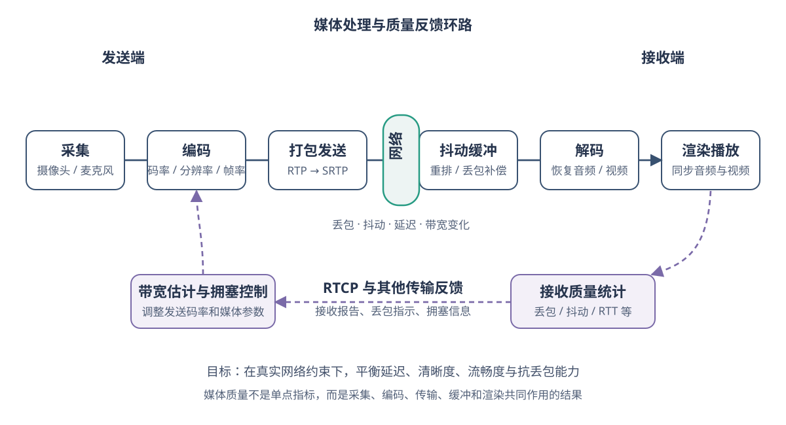

# 第 36 章 带宽估计

实时媒体不能简单地按照编码器能够产生的最高码率发送。网络的可用带宽会随时间变化，发送端却通常无法直接知道这个瞬时值，因此必须持续估计，并据此调整媒体码率与发包速度。本章讨论基于丢包和基于延迟的控制思路，以及接收端估计的 REMB、发送端估计的传输范围拥塞控制（Transport-Wide Congestion Control，TWCC），最后介绍与它们紧密相关的 pacing、probing 和 GCC。

## 估计目标与反馈闭环

带宽估计的目标，是尽量接近某一时刻真正可用的网络带宽。高估会把过多数据推入网络，引发拥塞和丢包；低估虽然更保守，却没有充分利用网络，同样会降低媒体质量。因此，“尽量低”或“尽量高”都不是合理目标，关键是随网络变化及时修正。

这里存在一个天然的分工：

- **接收端掌握直接观测结果。** 它知道哪些包没有到达，也能测量包实际到达的时间间隔。
- **发送端负责执行调整。** 它需要提高或降低编码码率，并控制实际发包过程。
- **两端之间必须有反馈。** 接收端可以把已经算好的目标码率交给发送端，也可以只回传观测数据，让发送端自行估计。

发送端并非完全无法获知丢包。它可以通过 RTCP 接收者报告（Receiver Report）事后了解丢包情况，但真正直接看到接收结果的仍是接收端。不同带宽估计方案的核心差别之一，就是估计逻辑放在哪一端、反馈中携带的是结论还是原始观测信息。

*图：接收质量反馈驱动发送端带宽估计与媒体参数调整。*

## 基于丢包与基于延迟的控制器

### 基于丢包的控制

最直观的方法是不断提高发送量，直到网络“抱怨”。控制器检查是否发生丢包：如果有丢包，就降低估计带宽和发送码率；如果没有，则可以尝试提高估计值。

这种方法实现相对简单，但反应较慢。丢包通常意味着拥塞已经发生，后续调整是在修复一个已经恶化的问题，而不是提前避开它。对于实时音视频，等到明显丢包再降速，质量损失往往已经出现。

### 基于延迟的控制

基于延迟的控制器试图在丢包之前发现拥塞征兆。若接收包的时间间隔与发送间隔基本一致，通常说明传输较为顺畅；若到达间隔开始增大，则可能意味着路径上的交换设备正在排队，缓冲区逐渐膨胀，未来可能进一步演变为丢包。

控制器因此不再只问“有没有丢包”，而是问“是否出现了到达延迟增长”。一旦发现这种趋势，就可以提前降低带宽估计；没有延迟增长时，再考虑提高估计值。

这种方法对潜在带宽变化反应更快，但实现更困难。它需要发送端与接收端更紧密地配合，也需要更多启发式规则来判断延迟变化是否真的意味着即将拥塞。延迟估计不是简单读取一个数值，而是要根据发送时间、到达时间及其变化作出判断。

## REMB：接收端估计最大码率

接收端估计最大码率（Receiver Estimated Maximum Bitrate，REMB）是课程介绍的较早、也较常见的接收端带宽估计方式。其基本职责划分是：接收端完成估计，再把允许发送端使用的最大码率通过反馈消息送回去。

### 媒体与反馈路径

REMB 的工作过程可以概括为：

1. 双方通过 SDP 表明对 REMB 的支持。课程指出，相关 SDP 属性带有 `goog` 前缀，反映其在课程录制时仍属于草案或建议，而非已经完成标准化的机制。
2. 发送端发送媒体，并在视频 RTP 包中携带实际发送时间信息。
3. 接收端依据接收情况计算新的最大码率估计。
4. 需要调整时，接收端通过 RTCP 的 REMB 反馈消息返回估计值，发送端据此改变发送码率。

课程所示反馈包的负载类型为 206，其中包含 REMB 标识。最大码率使用尾数和指数共同表示，从而能够编码不同范围的估计值。这里真正重要的是“接收端计算并反馈目标最大码率”，而不是把某种具体估计算法写死在协议中。

### 为什么 RTP 时间戳不等于发送时间

RTP 时间戳描述的是媒体采样时间，例如摄像头生成一帧或麦克风取得音频数据的时间。数据真正进入网络的时间可能更晚，原因包括编码器延迟以及后文介绍的发包 pacing。若把采样时间误当作发送时间，就无法准确比较发送间隔和到达间隔。

因此，REMB 方案使用绝对发送时间（absolute send time）RTP 头部扩展，为 RTP 包增加实际发送时间戳。这个扩展对应课程提到的 `abs-send-time` 草案。它补充的是网络传输观测所需的信息，并不取代原有的媒体时间戳。

### 估计逻辑与异常处理

REMB 的逻辑分布在两端：发送端负责打发送时间戳并实际发包，接收端负责估计码率。至于接收端究竟如何根据丢包、延迟等数据算出最大码率，不属于该规范规定的范围，而由实现者决定。

发送端也不能假设每条 REMB 消息都会到达。反馈本身可能因丢包而缺失；如果 RTCP 接收者报告同时显示严重丢包，发送端仍需具备相应处理逻辑，不能无限等待下一条估计结果。

按课程录制时的状态，REMB 自 2013 年起一直处于草案阶段。它实现相对简单，能够提供可用但并非最佳的结果。Google 的投入重点随后转向 Transport CC，因此理解 REMB 仍有兼容性价值，但新课程建议把更多注意力放在 TWCC 上。

## TWCC：发送端进行带宽估计

传输范围拥塞控制（Transport-Wide Congestion Control，TWCC，也称 Transport CC 或 TCC）把估计逻辑集中到发送端。接收端不再直接给出“请使用某个最大码率”的结论，而是反馈传输观测结果，由发送端计算估计值。

这种分工对媒体服务器尤其有意义：服务器可以在发送侧采用自己的带宽估计算法，而不必把算法作为 WebRTC 开源实现的一部分公开。

### 全局序列号与发送时间记录

双方同样先通过 SDP 表明对 Transport CC 及相关 RTP 头部扩展的支持。随后，发送端为 RTP 包添加传输范围序列号，并保存每个序列号对应的实际发送时间。

这个序列号有几个关键特征：

- 长度为 16 位；
- 以 RTP 头部扩展的形式携带；
- 对同一套接字上发送的包递增，而不是为音频和每一路视频分别维护一套编号；
- 每发送一个包就加一，无论该包属于音频、视频，还是同一连接中的某一路视频。

因此，它与单个 RTP 流内部的普通序列号不是同一个概念。发送端需要保留“全局序列号—发送时间”的对应关系，供后续计算使用。

### 接收端反馈到达间隔

接收端根据传输范围序列号识别所收到的包，计算相邻包之间的到达时间差，再通过 RTCP 传输反馈把结果送回发送端。例如，收到编号 1、2、3、4 的包后，可以报告 1 到 2、2 到 3、3 到 4 分别经历了怎样的接收间隔。

TWCC 的 RTCP 反馈格式比 REMB 更复杂。课程重点指出其中的三类信息：报告起始的基础序列号、该报告覆盖的包数量，以及这些包的到达延迟信息。课程示例以基础序列号及其后的 16 个包说明报告范围，并没有展开完整字段布局。

发送端拿到反馈后，把自己保存的发送间隔与接收端报告的到达间隔进行比较，再决定提高还是降低码率。至此，测量来自接收端，比较、估计和发送决策都集中在发送端。

### 实现与部署权衡

按课程录制时的资料，TWCC 自 2015 年起处于草案阶段，Chrome 在 2016 年初实现了它。它比 REMB 更复杂，在 SFU 等媒体服务器上尤其如此，但能够带来更准确、更好的码率爬升表现。

课程还提到，Google Meet 与 Stadia 分别使用了不同的服务器端带宽估计算法。这说明“采用 TWCC”并不等于所有产品都采用同一种估计策略；传输反馈机制与具体控制算法应当区分。

从兼容角度看，课程建议同时支持 REMB 和 TWCC。其当时的判断是：浏览器普遍支持 REMB，TWCC 的支持也已较广；媒体服务器则并非都支持 TWCC。具体选型应覆盖实际客户端和服务器组合，而不能只依据其中一端的能力。

## Pacing：把码率落实到发包时间

视频帧天然具有突发性。I 帧通常较大，只有少量画面变化的讲话场景可能产生较小帧，静态演示内容则可能在很多帧上只产生很少数据。即使平均目标码率不变，如果把这些数据不加控制地瞬间推入网络，也可能造成短时拥塞。

Pacing 关注的就是“什么时候发送每个包”。WebRTC 实现中的 pacer 根据估计出的最大码率整形发包过程：当待发送数据过多时，适当延后一部分包，使网络中的发送速率更接近目标，而不是在一个突发中越过可用带宽。

这看起来像是在主动增加等待，却通常能改善网络表现和视频质量。它还进一步说明了采样时间戳为什么不能替代发送时间：pacer 本身就会使数据生成时间与实际发包时间产生差异。

## Probing：主动测试更高可用带宽

估计带宽需要足够的数据量。如果当前只发送 100 kbps，就无法仅凭这段流量判断网络是否能够承载 2 Mbps。要提高估计值，就必须以某种方式探测更高发送速率。

直接增加真实视频数据并不理想。一旦探测过度，视频包丢失可能触发新的 I 帧请求，而 I 帧又会形成更大的网络突发，使问题进一步恶化。因此，会话开始等阶段可以使用额外填充数据进行 probing，以较低风险了解网络还能承载多少流量。

这些额外数据可以是重传的真实包，也可以是填充性的无效数据，具体取决于会话协商和实现。课程给出的 Chrome WebRTC 统计示例中，会话初期的头部字节数会出现一段上升，随后恢复正常；这部分额外开销被用于改善网络估计。这里应把 probing 看作有意的测量过程，而不是误把短期流量上升当成媒体本身需要更高码率。

## GCC 与具体估计算法

丢包、延迟、REMB 和 TWCC 解决了“观测什么、在哪里估计、如何反馈”的问题，却没有完整回答“最终应该算出多少码率”。Google 拥塞控制（Google Congestion Control，GCC）正面向后一个问题：已知延迟或丢包信息后，如何得到合适的带宽估计值。

课程提到，Google 曾尝试通过草案推动相关标准化，libwebrtc 的 REMB 与 TWCC 实现中也包含了这些概念的部分实现。如果需要在 libwebrtc 之外的服务器或自有客户端中实现估计，可以研究相应代码和草案。但具体算法仍是实现者需要设计和验证的部分，不能仅凭 SDP 中声明支持某种机制就假定估计质量相同。

## 小结

带宽估计是一条从接收观测到发送调整的闭环。基于丢包的控制简单但滞后，基于延迟的控制能够更早发现排队，却需要更复杂的协作与判断。REMB 由接收端计算并反馈最大码率，TWCC 则把估计决策集中到发送端。无论选择哪种机制，实际媒体质量还取决于发送时间测量、pacing、probing 以及具体拥塞控制算法；协议支持只是这条链路的起点。
