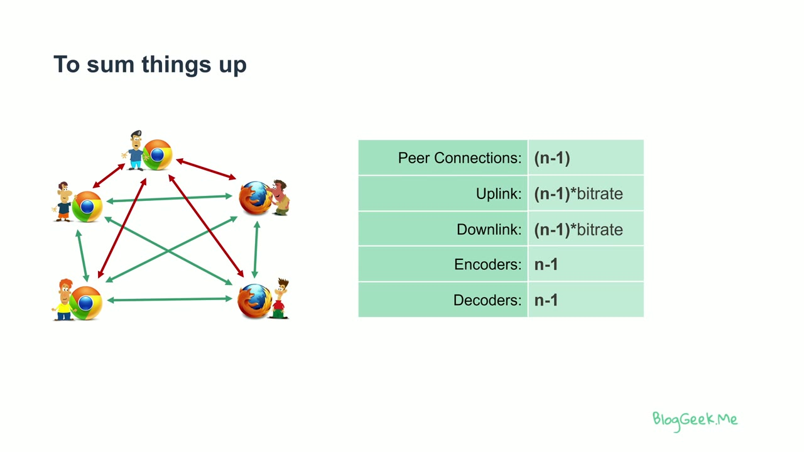

# 第 37 章 Mesh 架构

一对一 WebRTC 通话中，双方通过应用服务器交换提议、应答等信令，媒体则可以直接在浏览器之间点对点传输。当会话加入第三个、第四个乃至更多参与者时，必须重新回答一个问题：每个人的媒体应当沿什么路径到达其他所有人？Mesh 是最直接的答案——让每个参与者都向其他每个参与者发送媒体，并从他们那里接收媒体。

## 从一对一通话到多方媒体路径

Mesh 中的每个参与者都与其他参与者建立直接的对等连接，形成两两相连的结构。以三个参与者为例，每个人都要连接另外两人；再加入一人时，新成员必须与此前所有成员建立连接，已有成员也分别增加一条通往新成员的连接。

这里需要区分信令路径与媒体路径：

- **信令仍然需要服务器。** 各参与者的提议与应答、ICE 候选交换等消息，仍由信令服务器在客户端之间传递和路由。
- **媒体不经过专门的媒体服务器。** 媒体直接在各个对等端之间传输；无法直连时，可以由 TURN 服务器中继。
- **TURN 中继不等于集中式媒体处理。** 即使媒体因网络条件经过 TURN，Mesh 的基本组织方式仍是每对参与者分别连接，而不是由服务器统一混音或选择转发。

因此，“无媒体服务器”并不意味着整个系统没有服务器，也不意味着所有媒体一定严格沿最短网络路径直连。Mesh 的核心是媒体处理和多路发送责任都留在客户端。

## 连接数与带宽增长

设参与者数量为 `N`，每一路音频与视频合计占用码率 `B`。在所有人都向其他所有人发送媒体的完整 Mesh 中：

- 每个参与者维护 `N - 1` 条对等连接；
- 全网两两连接的总数为 `N(N - 1) / 2`；
- 每个参与者的上行码率为 `(N - 1)B`，因为同一份媒体要分别发给其他每个人；
- 每个参与者的下行码率同样为 `(N - 1)B`，因为要接收其他每个人的媒体；
- 按课程示例，每个参与者需要 `N - 1` 个编码器和 `N - 1` 个解码器。

*图：完整 Mesh 中单个参与者的资源需求（课程幻灯片，00:05:12）。*

全网实际媒体流量为 `N(N - 1)B`，即 `N` 个发送者分别向 `N - 1` 个接收者发送码率 `B`。若在监控中把同一流量在发送端的上行和接收端的下行分别记账再相加，则会得到 `2N(N - 1)B`，两种统计口径不能混用。下面的数字沿用课程的简化假设：每个参与者的音频和视频合计为 1 Mbps，所有流采用相同或近似的码率。

| 参与者数 | 每人维护的对等连接 | 全网两两连接数 | 每人上行 | 每人下行 | 全网实际媒体流量（各方向合计） |
| --- | ---: | ---: | ---: | ---: | ---: |
| 3 | 2 | 3 | 2 Mbps | 2 Mbps | 6 Mbps |
| 4 | 3 | 6 | 3 Mbps | 3 Mbps | 12 Mbps |
| 5 | 4 | 10 | 4 Mbps | 4 Mbps | 20 Mbps |

新成员加入时，不只是新成员自己增加连接，所有已有成员也都要增加连接和媒体收发工作。单端的上行、下行、编码器与解码器数量随 `N - 1` 线性增长，而全网两两连接数和总媒体量增长得更快。这就是 Mesh 在小规模时直观、规模稍大便迅速失去吸引力的原因。

以五人通话为例，每个浏览器要同时运行四个编码器和四个解码器，并维持四条对等连接。若希望向其他所有人发送 720p 或高清视频，每路上行达到 1 Mbps 或更高，那么仅上行就需要约 4 Mbps，还没有计入连接管理及其他开销。

## Mesh 的优势

### 不需要集中式媒体服务器

Mesh 的所有媒体处理都在客户端完成。系统仍然需要信令服务器，并可能需要 TURN 服务器，但不需要 MCU、SFU 这类媒体服务器。由此省去了媒体服务器的部署、优化、维护，以及相应的媒体流量、数据中心计算和网络成本。

这种架构的概念也较简单：要把媒体送给谁，就与谁建立对等连接。服务器端不需要理解会议布局、执行编解码或决定如何组合媒体。

### 媒体路径直接，额外处理跳数少

在能够点对点直连的情况下，媒体从一个参与者直接流向另一个参与者，中间不增加媒体服务器这一跳，也不需要等待服务器解码、处理或转发。因此，Mesh 可以获得很低的媒体延迟。

不过，课程也提醒不必单独夸大这一点：许多采用 MCU 或 SFU 的互联网群呼虽然增加了服务器路径，实际延迟仍在用户可接受范围内。架构选择不能只看理论上最少的一跳，还要看带宽、计算和稳定性代价。

## 主要瓶颈与失效方式

### 上行带宽先成为限制

每个参与者都要把自己的媒体重复发送 `N - 1` 次，上行需求随人数线性增长。许多接入网络本身就是非对称的，下行能力高于上行能力。课程以 ADSL 为例，并指出一些网络的上行上限只有 1～2 Mbps。在这种环境中，即使下行仍有富余，多路上行视频也已经难以维持。

这意味着不能用“每个用户只采集一路摄像头画面”来推断“只产生一份上行流量”。在 Mesh 中，同一份内容要变成多份面向不同对等端的发送流量。

### 浏览器 CPU 与实现优化不足

视频编码和解码都需要计算资源。按课程所述的浏览器 WebRTC 实现，虽然理论上可以只生成一个编码码流再发给所有人，当时浏览器中的库并不会这样处理，而是需要并行运行多个编码器。人数增加后，浏览器 CPU 负载迅速加重，视频场景尤其明显。

课程认为浏览器并未针对大规模 Mesh 群呼充分优化，其优化重点是借助媒体服务器进行群组通话。因此，Mesh 视频方案不仅资源消耗高，而且很难在不同设备与网络组合上稳定下来。

### 多连接管理降低可靠性

每个新增参与者都会增加全系统的连接数量，也增加 ICE 协商、连接维护和故障排查的工作量。某几条对等连接未完全建立时，故障可能不是“所有人同时退出”，而是不对称的局部失联。例如，五人会话中的一人可能被部分参与者听到，却无法被另外两人听到；或者某客户端只成功连接了五人中的三人。

这种局部失败使问题更难定位。客户端代码必须跟踪多个连接及其状态，而每一对参与者之间的网络条件又可能不同。

## 适用范围与架构判断

课程给出的经验判断较为保守：在真实视频场景中，Mesh 往往在只有两三名参与者后就开始暴露问题；有些供应商声称能支持五人甚至八人，但课程不建议以此作为通用设计目标。纯语音的负载较低，五名左右的参与者可能仍可工作，但移动设备和旧设备同样会受到 CPU 与多编码器负担的影响。

因此，对于四人或更多参与者的通用群组视频通话，课程建议优先考虑 MCU 或 SFU 等其他架构，而不是继续扩大 Mesh。上述人数是课程基于当时浏览器与实际产品经验给出的判断，不应被理解为协议规定的硬上限。

Mesh 并非绝对不可用。以下情况仍可能有其价值：

- 参与者很少，且希望避免部署媒体服务器；
- 能控制或拥有客户端设备、CPU 能力和网络环境，可以提前验证资源上限；
- 某些特殊场景明确重视直接媒体路径，并能承受多连接管理成本。

此外还有**部分 Mesh**：某些参与者只需与特定参与者交谈或交换媒体，而不是与所有人两两连接。这种结构较少见，其连接与资源模型不能直接套用完整 Mesh。遇到这种需求时，应重新检查 Mesh 是否仍是最合适的方案，而不是默认把完整 Mesh 删除几条连接就得到最佳架构。

## 小结

Mesh 用最少的服务器媒体处理换取最直接的多方连接方式，但代价被集中转移给客户端。每个人的上行带宽、编解码器和对等连接数量都随其他参与者数量增长，全网的连接管理负担增长得更快。它适合人数很少、环境可控的场景；面对通用多人视频群呼，上行带宽、浏览器 CPU 和局部连接故障会成为比服务器成本更早出现的限制。
