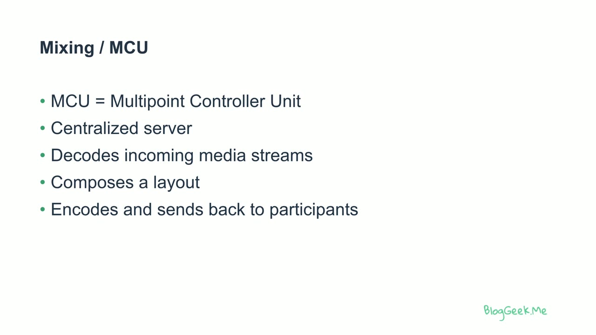
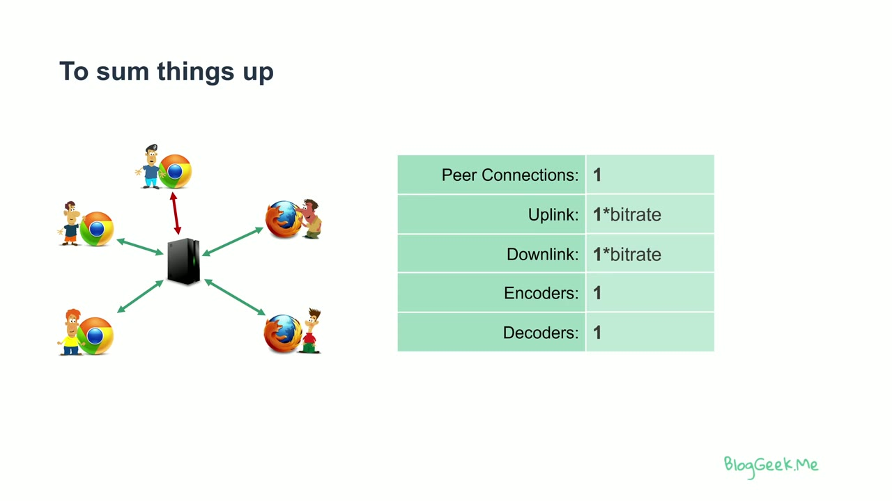

# 第 38 章 混音与 MCU

Mesh 把多方通话的媒体处理负担留在每个客户端，参与者越多，上行带宽、编码器数量和连接管理压力越大。多点控制单元（Multipoint Control Unit，MCU，也称多点会议单元）走向另一个极端：所有参与者只连接中央媒体服务器，由服务器接收、处理并重新生成媒体。客户端看到的不再是一组彼此相连的 PeerConnection，而是一条类似一对一通话的媒体路径。

## 从 Mesh 迁移到星型媒体路径

在完整 Mesh 中，每个客户端都要向其他所有参与者分别发送媒体，同时接收并解码多路媒体。其优点是服务器基础设施简单、数据中心额外成本低，缺点是媒体流数量迅速增加，单端上行需求线性增长，浏览器还要承担越来越多的编码工作。

MCU 使用星型结构改变这条路径：

1. 每个参与者把自己的媒体发送给中央 MCU；
2. MCU 接收所有输入流并完成会议所需的媒体处理；
3. MCU 将处理后的输出流发送给各参与者；
4. 客户端不再为每个远端参与者分别建立媒体连接、运行编码器。

复杂度并没有消失，而是从许多客户端转移到了中央服务器。这个转移使客户端行为接近一对一通话，也使服务器成为理解整个会议媒体状态的集中控制点。

## MCU 内部的媒体处理流程

MCU 的核心工作是混音与合成，而不是简单转发已经编码的数据。对视频而言，一条完整处理链通常包括以下阶段。

*图：MCU 的集中式媒体处理职责（课程幻灯片，00:02:26）。*

### 1. 接收并解码所有输入流

MCU 接收来自各参与者的媒体流，并将需要处理的视频逐路解码。接收和发送本身主要消耗网络资源，相对不占用大量 CPU；解码则是主要计算开销之一。

### 2. 按目标布局重新缩放

不同输入流可能具有不同分辨率。例如，一路输入为 720p，另一路为 VGA。若要把它们放入同一个输出画面，MCU 必须根据布局决定每一路在最终画面中的尺寸，并进行相应缩放。缩放会消耗额外 CPU，但课程将其开销描述为低于解码和编码。

### 3. 合成统一画面

缩放后的多路视频被放入一个输出帧或窗口中，形成会议布局。完成这一步后，多个独立输入已经变成一个视觉上统一的画面。客户端只需要解码这个合成结果，而不必分别解码并自行排布所有原始视频。

### 4. 编码并发送输出

合成画面必须重新编码后才能发送。MCU 可以只编码一次，把同一结果发给所有人；也可以针对每个参与者分别编码，甚至分别缩放、合成不同布局。

即使所有参与者使用同一个布局，实践上仍可能需要为特定参与者设置独立编码器，因为各用户的网络条件不同，需要适应的码率也不同。每增加一种个性化布局或编码输出，服务器都要承担更多计算工作。

| 处理阶段 | 主要资源特征 |
| --- | --- |
| 接收、发送媒体 | 主要消耗网络资源，CPU 开销相对较低 |
| 解码、编码 | CPU 开销很大，是 MCU 成本的主要来源 |
| 缩放、画面合成 | 同样消耗 CPU，课程中描述为低于编解码开销 |

这条处理链说明 MCU 通常是 **CPU 受限** 的系统。它并非只在网络层搬运数据，而是把压缩媒体还原、改造，再重新压缩。

## 星型结构的带宽与客户端资源

继续采用上一章的简化模型：每个参与者上传和下载的媒体都按 1 Mbps 计算。对于 `N` 名参与者，每人与 MCU 建立一条连接，全网共有 `N` 条客户端—服务器连接；每人的上行和下行都保持为 1 Mbps，全网上下行合计为 `2N Mbps`。

| 参与者数 | 每人连接数 | 全网客户端—MCU 连接数 | 每人上行 | 每人下行 | 全网实际媒体流量（各方向合计） |
| --- | ---: | ---: | ---: | ---: | ---: |
| 1 | 1 | 1 | 1 Mbps | 1 Mbps | 2 Mbps |
| 2 | 1 | 2 | 1 Mbps | 1 Mbps | 4 Mbps |
| 3 | 1 | 3 | 1 Mbps | 1 Mbps | 6 Mbps |
| 4 | 1 | 4 | 1 Mbps | 1 Mbps | 8 Mbps |
| 5 | 1 | 5 | 1 Mbps | 1 Mbps | 10 Mbps |

从每个客户端的视角看，不论会议中有多少人，它都只需要一条面向 MCU 的对等连接、稳定的一路上行与一路下行媒体，以及一个编码器和一个解码器。这与 Mesh 中每项资源都随 `N - 1` 增长形成鲜明对比。

*图：MCU 星型结构中的客户端资源模型（课程幻灯片，00:06:27）。*

这里的“一路下行”是 MCU 已经混合或合成后的结果，不代表服务器只处理了一路输入。客户端资源需求保持稳定，正是因为服务器替它接收并处理了其余参与者的媒体。

## MCU 的优势

### 客户端简单，适应异构设备

客户端不需要为群呼增加新的媒体处理要求，其行为类似进行一场双向的一对一通话。这降低了终端参与大型会议的门槛，也有利于支持能力和类型差异较大的客户端。复杂设备适配、媒体组合和协议衔接可以集中放到 MCU 侧。

### 集中控制会议与媒体

MCU 持续掌握会议中的输入与输出媒体，是集中管理会话的自然位置。需要增加录制、联邦互联或网关功能时，只需围绕这个统一接入点实现和支持，而不必修改每个客户端之间的媒体路径。

MCU 因而也常作为连接外部系统的网关。它能够把 WebRTC 会议与其他平台或协议连接起来，并把多方媒体整理成外部系统更容易接受的形式。

### 便于录制和对外直播

许多录制、内容分发和直播平台需要单一媒体流。MCU 已经生成了合成后的单流，因此将会议录制下来，或推送到 CDN 通过 HLS 直播、输出到 YouTube Live 等场景，都可以直接从这一阶段继续处理。

这并不意味着所有录制都必须使用完整视频 MCU，而是说明“已经混合好的单流”与这些下游系统的输入要求非常契合。即使主通话采用其他架构，录制或 CDN 导出环节仍可能需要一个类似 MCU 的处理组件。

## 成本、扩展性与灵活性限制

### 服务器成本和扩展压力

MCU 的解码、缩放、合成与重新编码都需要大量计算资源，构建、运行和维护成本较高。免费或增值服务虽然可以向用户提供低价格，却仍要由服务提供方承担服务器费用，因此 MCU 很难适应强调低边际成本的业务模式。

扩展同样受 CPU 制约。课程用支持 10、100、200 名参与者与扩展到千人以上的对比说明这种难度，而不是给出所有 MCU 通用的固定容量上限。实际能力取决于处理和输出方式，但增加参与者通常会显著增加服务器编解码工作。

### 统一布局与个性化需求之间的矛盾

大规模会议的参与者往往是不对称的：设备性能、屏幕尺寸、可用带宽和希望观看的内容都不同。如果 MCU 只合成一个布局并发送给所有人，客户端就无法自由选择要看的原始视频，也无法灵活改变与这些视频的交互方式，因为它只收到一个合成后的视频流。

若为了适应这些差异，为每个参与者分别合成布局、调整分辨率并独立编码，灵活性会提高，但服务器 CPU 消耗也随之增加。MCU 的核心权衡因此不是简单的“统一输出好”或“个性化输出好”，而是客户端简洁性与服务器计算成本之间的选择。

## 音频 MCU 仍有独立价值

视频 MCU 的处理成本很高，音频 MCU 却在许多场景中依然实用。

- **电话会议。** FreeSWITCH、Asterisk 等现成方案可以较高效、经济地接收并混合音频，相关应用已经十分常见。
- **PSTN 桥接。** 如果 WebRTC 群呼需要接入电话号码和传统电话系统，就需要把电话参与者与其他架构中的参与者进行音频混合和桥接。
- **大型群组的空间音频。** 若需要 3D 音频，让不同声音来自不同位置，或者需要在大群组中精细控制听觉效果，音频混合比单纯路由更容易实现完整目标。
- **大型观众声音。** 比赛现场观众鼓掌、足球赛观众呐喊等场景需要把许多人的声音共同呈现出来，不能只靠选择少数音频流转发。

课程在比较路由方案时还指出，客户端同时可听到的参与者数量会受到限制，并举例称浏览器只混合音量最大的三名参与者。这个例子用于说明纯路由为何难以承载大型群体的完整声音，而不应脱离具体方案把它当成所有音频产品的固定限制。

## 设计与选型时需要核对的能力

不同 MCU 的处理能力和输出策略并不相同。选择或实现 MCU 时，至少需要明确以下问题：

1. **分辨率与布局**：支持哪些输入、输出分辨率？是否只有一种合成布局，还是能为不同参与者生成不同布局？
2. **编解码器覆盖**：解码端和编码端分别支持哪些编解码器？多个编码器能否分别使用不同编解码器？
3. **转码能力**：能否接收 VP8 视频并输出 VP9？若需要跨越不同客户端能力，转码将在哪里完成？
4. **帧率转换**：能否把接收到的 30 fps 视频转换为另一端需要的 10 fps 或 15 fps？这些处理会进一步增加怎样的开销？
5. **软硬件实现**：编码、解码和缩放是否有硬件加速可用？软件方案能否满足目标容量？
6. **编码器分配**：只编码一次并假设所有人接收相同码率，还是每个参与者一个编码器？是否还要为每个人单独合成？

选项越偏向个性化，越能照顾不同网络和设备，但服务器端 CPU 压力也越大。不能只比较功能列表，还要把这些功能映射回解码、缩放、合成和编码各阶段的实际成本。

## 小结

MCU 通过星型媒体路径把群呼复杂度集中到服务器：每个客户端只上传一路、下载一路，并使用一个编码器和一个解码器；服务器则解码多路输入，完成缩放、混合或画面合成，再编码输出。它特别适合要求客户端简单、集中控制、单流录制或外部协议互联的场景，音频混合在电话和大型群体声音场景中也仍有优势。其主要限制是 CPU 成本、扩展难度，以及统一布局与个性化输出之间的矛盾。
