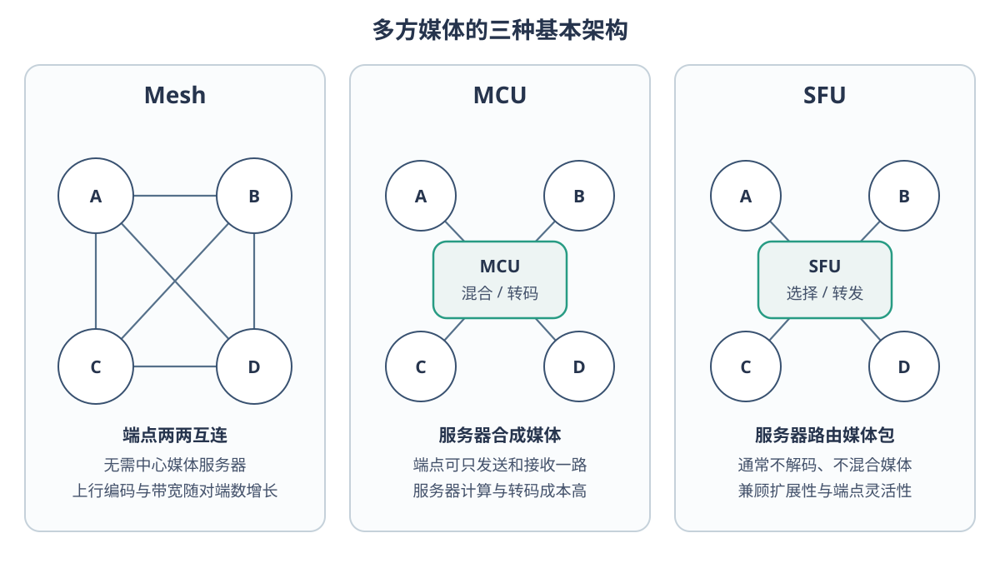

# 第 39 章 路由与 SFU

Mesh 把媒体处理全部留给客户端，MCU 则把解码、合成和重新编码集中在服务器。选择性转发单元（Selective Forwarding Unit，SFU）位于这两种极端之间：客户端仍负责编码和解码，服务器参与媒体传输，却不执行完整的媒体处理。SFU 的价值不只是“多了一台转发服务器”，而是通过选择发送哪些流、哪些层，在客户端灵活性、服务器计算成本和网络消耗之间进行调节。

## 为什么需要 SFU

随着参与者增加，Mesh 的连接、上行流量和客户端编码工作迅速增长，很难承载几十人乃至更大的会议。MCU 能让每个客户端始终保持一对一式的连接和编解码负担，却要解码、缩放、合成并重新编码视频，服务器 CPU 成本和扩展压力很高。

SFU 试图保留两者的部分优势：

- 由服务器集中接收和分发媒体，避免每个客户端向所有其他客户端分别上传；
- 不在服务器上解码、合成和重新编码，省去 MCU 最昂贵的处理阶段；
- 让客户端保留布局和设备适配能力，而不是只接收一个固定合成画面；
- 通过流选择和分层编码减少不必要的下行流量与解码工作。

因此，SFU 并没有消除媒体处理，而是重新划分职责：服务器负责路由和选择，客户端负责生成、解码以及展示媒体。

## SFU 的媒体路径与主要瓶颈

SFU 是类似 MCU 的集中式媒体服务器，但其内部处理链短得多：

1. 接收参与者发送的媒体流；
2. 检查媒体流及其标识，判断哪些参与者需要哪些流或层；
3. 将选中的媒体转发给相应参与者。

它不把多路视频解码后合成一个画面，也不为每个接收者重新编码。在这一简化模型中，SFU 主要不是受视频编解码 CPU 限制，而是受网络收发能力限制。服务器能接收多少数据、同时向外发送多少数据，成为容量设计的关键。

“选择性”与“转发”同样重要。如果服务器只是无条件复制所有流，下行带宽和解码压力仍会随参与者增加；只有结合会议布局、设备能力和网络状态进行选择，SFU 的扩展优势才能充分发挥。

## 带宽与编解码资源模型

沿用前两章的简化假设：每个参与者向 SFU 上传一路音频和视频，合计码率为 `B`，并接收其他每个参与者的一路媒体。对 `N` 名参与者：

- 每人的上行码率为 `B`，只向 SFU 发送一份媒体；
- 每人的下行码率为 `(N - 1)B`；
- 每人只需一个发送编码器，但在完整接收模型中需要 `N - 1` 个解码器；
- SFU 的全网入口流量合计为 `NB`，出口流量合计为 `N(N - 1)B`；
- 若把进入和离开 SFU 的媒体量相加，总量为 `N²B`。

当 `B = 1 Mbps` 时，课程示例中的数字如下：

| 参与者数 | 每人上行 | 每人下行 | 每人发送编码器 | 每人接收解码器 | SFU 入口与出口合计 |
| --- | ---: | ---: | ---: | ---: | ---: |
| 2 | 1 Mbps | 1 Mbps | 1 | 1 | 4 Mbps |
| 3 | 1 Mbps | 2 Mbps | 1 | 2 | 9 Mbps |
| 4 | 1 Mbps | 3 Mbps | 1 | 3 | 16 Mbps |
| 5 | 1 Mbps | 4 Mbps | 1 | 4 | 25 Mbps |

这些数字统计的是媒体流量和逻辑媒体路径，不能直接当作浏览器 PeerConnection 数量。课程特别指出，可以把同一参与者的多路流复用在一条 PeerConnection 中，使每端只维护一条 PeerConnection，而不是为每一次上行或下行转发各建一条。

### 五人通话中的三种架构对比

在五人、每路媒体 1 Mbps 的同一假设下，三种架构呈现出不同的瓶颈：

*图：Mesh 端点两两互连，MCU 在服务器混合媒体，SFU 在服务器选择并转发媒体。*

| 架构 | 每人上行 | 每人下行 | 全网实际媒体流量（各方向合计） | 主要计算位置 |
| --- | ---: | ---: | ---: | --- |
| Mesh | 4 Mbps | 4 Mbps | 20 Mbps | 每个客户端多路编码、解码 |
| MCU | 1 Mbps | 1 Mbps | 10 Mbps | 服务器解码、缩放、合成、编码 |
| SFU | 1 Mbps | 4 Mbps | 25 Mbps | 客户端编码与多路解码，服务器路由 |

SFU 的全网总媒体量在这个模型中反而最高，因为所有媒体都要先进入服务器，再从服务器发往接收者，比 Mesh 多经过一段服务器转发路径。它与 MCU 的低成本优势主要体现在**省去服务器视频编解码**，而不是无条件减少全网总流量。

SFU 把客户端最沉重的上行多份编码降为一次编码、一份上行，同时保留客户端多路解码。接下来的优化重点自然转向连接数量、下行码率和流选择。课程以五人示例说明，除了把每端 PeerConnection 减为一条，还可以降低来自其他参与者的接收码率，把每端下行从 4 Mbps 调整为 3、2 或 1 Mbps；这通常需要结合 Simulcast 或 SVC，同时也会降低 SFU 的出口和全网总流量。

## 优势与实现代价

### 服务器更容易扩展，客户端保持灵活

SFU 不需要执行 MCU 式的视频解码和编码，因此服务器端更容易扩展，成本也低于完整混合方案。课程将其称为实现视频处理的经济型后端方案；与完全不使用媒体服务器的 Mesh 相比，它又能支撑更大的会话。

客户端仍然是“智能”的，可以按自身屏幕、布局、网络和设备能力决定如何展示多路媒体。不同用户可以观看不同内容，而不必共同接受 MCU 生成的一个固定画面。这种灵活性对大型会议尤其重要。

### 客户端仍重于 MCU，系统调优复杂

SFU 客户端通常比 MCU 客户端消耗更多 CPU，因为它可能要解码多路视频。这里的关键不是机械地接受每人一定下载 4、5 或 10 Mbps，而是理解未优化的多路下行会同时带来网络和解码负担。

SFU 方案还需要大量应用层决策：

- 客户端应向服务器提供哪些流和哪些层？
- 服务器应向每个客户端提供哪些内容？
- 由谁判断网络、设备和布局变化？
- 如何使码流匹配接收端能力？
- 所有端使用单一编解码器，还是需要支持多个编解码器？
- 面对不同分辨率和设备能力，怎样避免无效发送与解码？

因此，SFU 的服务器处理链虽然短，完整产品的实现复杂度却并不低。大量工作会花在优化、微调和明确客户端与服务器的职责边界上。

## Simulcast：发送多个独立编码版本

同时联播（Simulcast）让发送端把相同内容编码多次，形成多个独立视频流。每个流可以具有不同码率、分辨率和帧率，SFU 再按接收者情况选择其中一个转发。

课程给出的常见示例是三层：

| 层次 | 示例码率 | 适用意图 |
| --- | ---: | --- |
| 低层 | 约 150 kbps | 低端设备或较差网络 |
| 中层 | 约 500 kbps | 介于高低能力之间的接收需求 |
| 高层 | 约 1.5 Mbps 或更高 | 网络和 CPU 条件较好的设备 |

这些数值不是固定标准。层数通常在一至三层之间，具体码率、分辨率、帧率和是否保留中层，都应根据应用体验选择。一个网络和 CPU 条件良好的笔记本电脑可以接收高层，低端设备则可以只接收约 150 kbps 的低层。

### SFU 如何选择流

选择策略高度依赖应用，可参考的因素包括：

- 接收端可用带宽与设备能力；
- 视频在当前布局中的尺寸和重要程度；
- 哪位参与者正在发言或更需要被关注；
- 参与者是否静音，以及应用定义的其他优先级；
- 用户角色，例如教师与学生需要看到的界面可能不同。

不同客户端可以接收不同频道和不同层次，不必使用统一策略。重要流可以分配较高层，次要流则使用较低层，把有限下行带宽和解码资源优先用于用户真正关注的内容。

### Simulcast 的成本与动态优化

为了同时提供多个版本，发送端要多次编码并上传多个流。相比只发送一个 1.5 Mbps 高层，它会增加发送 CPU 和上行带宽消耗，因此需要按实际观看情况动态调整。

课程给出的典型优化是：当前发言者正在被所有人全屏观看，并且所有接收者都订阅 1.5 Mbps 高层，那么低层和中层暂时没有任何接收者，发送端可以停止发送这两层，使该阶段近似退化为单流发送。有人需要较低层时，再将其加入。

这一思路可以扩展为一套动态策略：

1. 根据最低端设备、弱网需求和目标最高体验确定各层配置；
2. 只保留当前有人观看的层，无人使用的层可以暂停；
3. 随网络变化、参与者位置变化和布局切换动态增删层；
4. 独立处理每个接收客户端，而不是假设整个会议需求一致；
5. 给重要流更高优先级，给静音或非发言等次要流较低码率。

Simulcast 因而不仅是“多发两份视频”，而是一套发送端、SFU 与接收端共同维护的供需匹配机制。

## SVC：在一个码流中组织可丢弃层

可伸缩视频编码（Scalable Video Coding，SVC）采用另一种分层方式。编码器只进行一次分层编码，把多个层组织在同一个媒体码流中；解码器可以只使用其中一部分层，SFU 也可以选择不转发全部层。

与 Simulcast 的多个独立编码流相比，SVC 更像一个可以逐层剥离的结构：保留基础层即可得到基本画面，增加增强层则提高帧率、分辨率或质量。

### 三种可伸缩维度

| 维度 | 增加层带来的效果 | 丢弃层的影响 |
| --- | --- | --- |
| 时间可伸缩性（Temporal） | 在前一层基础上增加帧，提高帧率 | 减少可显示的帧，降低帧率 |
| 空间可伸缩性（Spatial） | 提高同一帧的分辨率 | 保留较低空间层，降低分辨率 |
| 信噪比可伸缩性（SNR） | 在分辨率不变时投入更多比特，提高每帧质量 | 保留基本质量，减少质量增强信息 |

SNR 分层可以类比渐进式 JPEG：随着更多数据到达，同一幅图像的质量逐步提高。课程指出，这种方式在其录制时并不常见，相关 AV1 方案的说明也不是以此为重点。

时间层和空间层还可以组合。课程用 `S0T0` 表示空间层 0、时间层 0，后续层分别增加空间或时间能力。在一个 720p、30 fps 的组合示例中：

- 丢弃全部 `S1` 空间增强层，可降为 VGA，同时保持 30 fps；
- 丢弃 `T2` 时间增强层，可在保持 720p 时降为 15 fps；
- 在该示例的依赖结构中进一步只保留 `T0`，可降到 7.5 fps。

这些数值属于课程给定的分层示例，并非任意 SVC 码流都固定具有这些档位。真正可选择哪些组合，取决于编码时建立的层与依赖关系。

### 依赖关系与抗损能力

视频解码依赖参考关系，一些基础帧或基础层被后续更多数据依赖，其丢失影响也更大。SVC 通过明确的层间依赖，让 SFU 和保护策略可以区别处理这些数据：优先保护被大量后续帧依赖的基础部分，在网络不佳时丢弃影响较小的增强部分。

课程以 F1、F2 等帧的依赖关系说明，可以只为关键基础部分增加纠错保护；若其他不被后续依赖的帧丢失，接收端可以跳过它们，而不让整个时间段的码流都无法解码。这里的重点不是死记帧编号，而是理解**分层让码率调整与抗丢包保护能够利用依赖结构**。

SVC 因此既提供类似 Simulcast 的可伸缩性，又能在单一分层码流中更细致地选择数据，并提供额外的抗损设计空间。

### Simulcast 与 SVC 的选择

| 对比项 | Simulcast | SVC |
| --- | --- | --- |
| 编码方式 | 同一内容独立编码多次 | 一次编码，码流内部包含多个依赖层 |
| 发送形态 | 多个独立视频流 | 一个分层媒体流 |
| SFU 选择单位 | 选择某个独立流 | 选择保留或剥离码流中的层 |
| 主要代价 | 多次编码与多流上行开销 | 编码、依赖设计和实现支持更复杂 |
| 调整能力 | 按流切换，动态增删独立层 | 可组合时间、空间等维度，粒度更细 |

按课程录制时的生态状况，SVC 长期处在“接近可用”的状态：实现已有支持，但文档不足，有时需要逆向分析 Google Meet 的做法。课程列举了 Jitsi Meet 对 VP9 SVC 的支持。VP9 支持本章所述的完整 SVC 分层方式；VP8 在课程实现中支持时间可扩展性，但不具备与 VP9 相同的空间／时间 SVC 能力组合；H.264 的相关支持在课程所述 WebRTC 实现中仍不完整。AV1 实现能够支持分层，但当时 AV1 整体仍较新。这些属于课程当时的技术背景，不应直接当作此后各产品支持状态的结论。

## 小结

SFU 用集中路由消除了 Mesh 的多份上行和多个发送编码器，又避开了 MCU 的服务器端视频编解码。它的主要瓶颈转移到网络吞吐、客户端多路解码，以及如何选择合适的流。Simulcast 以多个独立编码版本换取选择空间，代价是发送 CPU 和上行流量；SVC 则在单个码流内组织时间、空间或质量层，允许更细粒度转发并利用依赖关系增强抗损能力。真正的扩展效果来自动态选择、分层配置和按需增删，而不是简单部署一台转发服务器。
