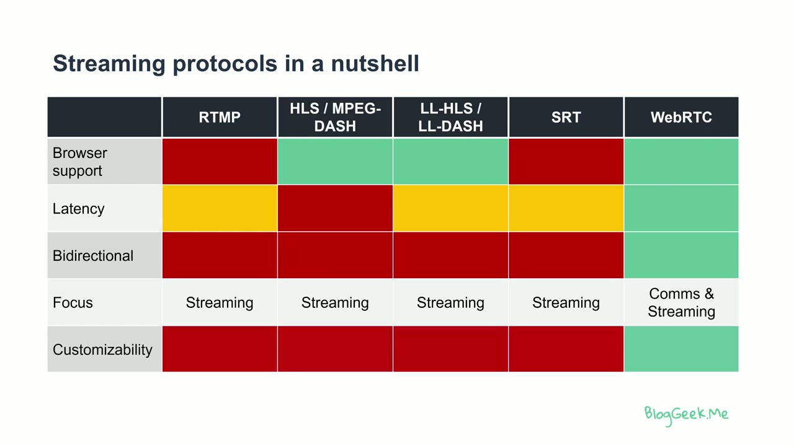
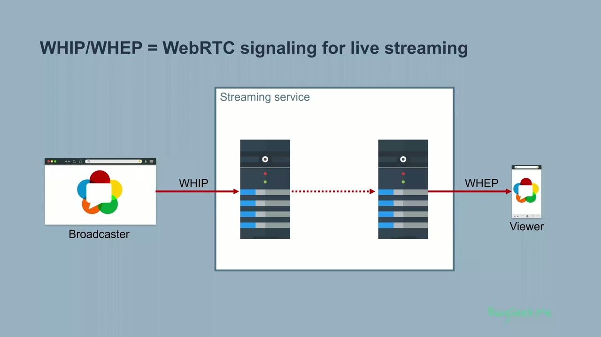
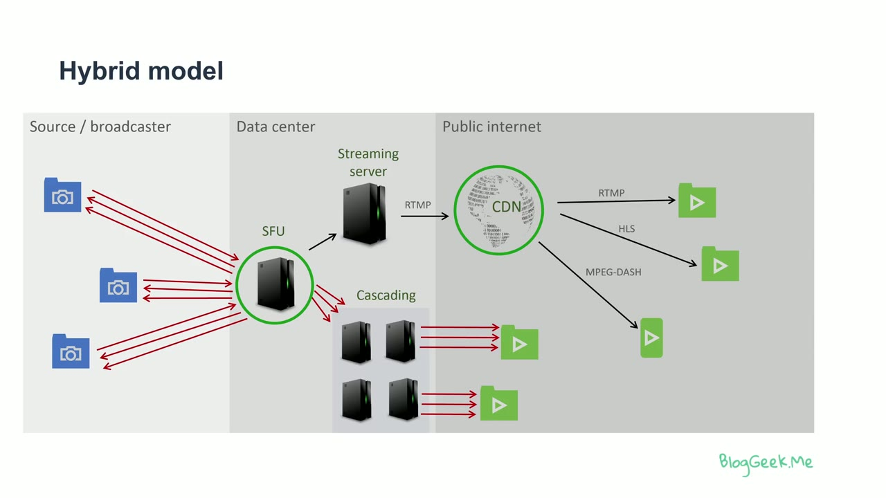

# 第 55 章 网络研讨会：低延迟直播

网络研讨会和直播看似都是“把媒体传给观众”，实际却对延迟有着截然不同的要求。只提供文字聊天、投票或问答时，数秒延迟通常可以接受；一旦观众要用自己的声音提问，或多个主播需要实时交谈，延迟就会直接影响交互。设计直播架构时，应先确定交互程度，再选择协议、媒体处理方式和分发拓扑。

## 为什么直播需要低延迟

人们对等待的容忍度正在降低：网页希望在一两秒内打开，分析结果希望实时呈现，商品可以当日送达。直播也受到同样趋势的影响，而且观众不再满足于被动观看，而是希望参与其中。

低延迟在以下场景中尤其重要：

- **体育赛事**：观众不希望先听到邻居为进球欢呼，随后才在自己的屏幕上看到进球。
- **体育竞猜、在线赌场和在线拍卖**：操作需要针对“现在正在发生”的事情，过时的画面会破坏活动本身。
- **游戏、云游戏和多人游戏**：输入与画面响应的速度可能直接决定输赢。
- **社交网络和电子商务**：直播越来越多地与实时互动结合。
- **网络研讨会**：如果只有一位讲者发言，其他人通过文字提问，低延迟并非必需；如果观众可以开麦提问，或多位嘉宾需要对话，交互越强，就越需要 WebRTC 这类实时通信技术。

因此，“直播”不是充分的选型依据，“直播过程中需要怎样的互动”才是。

## 协议延迟与能力对比

不同协议的典型延迟处于不同量级。下表保留课程给出的近似范围，用来比较设计取向，而不是作为任何部署都能达到的性能承诺。

| 协议或技术 | 课程给出的典型延迟 | 浏览器与使用位置 | 主要特点 |
| --- | --- | --- | --- |
| HLS、MPEG-DASH | 通常 20 秒以上，实际常见为广播后 10～30 秒 | 可在浏览器播放 | 适合可容忍较高延迟的大规模流媒体分发 |
| LL-HLS、LL-DASH | 约 2～10 秒，可采用或不采用 CMAF | 可在浏览器播放 | 基本沿用 HLS、DASH 的技术，通过不同配置缩短延迟；LL-HLS 可接近 2 秒 |
| RTMP | 约 2 秒，也可压到 1 秒甚至更低 | 课程所述环境中不能直接在浏览器使用 | 单向流媒体传输，常用于直播链路 |
| SRT | 约 2 秒 | 不直接在浏览器运行，主要用于后端 | 单向媒体传输 |
| WebTransport | 课程所引实验约 0.5～5 秒，取决于实现 | 课程录制时仍较新 | 灵活，但许多实时媒体能力需要自行实现 |
| WebRTC | 约 0.5 秒，强调亚秒级 | 原生面向浏览器等实时端点 | 支持双向音视频，优先保证实时性 |

*图：直播协议在浏览器支持、延迟、双向能力和设计目标上的差异（课程幻灯片，00:07:20）。*

这些方案的差异不只是秒数。

### 双向能力与浏览器支持

RTMP 和 SRT 不能按这里的方式直接在浏览器中运行；浏览器可以使用 HLS、MPEG-DASH 及其低延迟变体，也可以使用 WebRTC。延迟方面，WebRTC 最适合亚秒级交互，传统 HLS 和 MPEG-DASH 则不属于低延迟方案。

这组协议中，WebRTC 的独特之处还在于**双向通信**。其他协议主要面向单向分发，这正适合广播；但当互动本身包含音频和视频时，就需要 WebRTC 或其他实时通信机制。

### 流媒体与实时通信的设计目标

HLS、DASH、RTMP、SRT 等协议以流媒体为中心，WebRTC 则以双向通信为中心，流媒体分发是后来叠加到其生态中的用法。这不意味着 WebRTC 不能用于直播，而是说明它不是专门为大规模单向直播设计的，往往需要组合协议的一部分能力和外部基础设施，才能满足具体场景。

RTMP、SRT、HLS、LL-HLS 等方案相对简单，可定制空间有限；WebRTC 的可定制性更强。WebTransport 把更多控制权交给开发者，但控制权也意味着责任。

课程对比中指出，WebTransport 与 WebRTC 都可使用 UDP 和 TCP，WebTransport 不需要 WebRTC 那样的 NAT 穿透过程，基础设施可以更简单。然而，课程录制时的 WebTransport 仍缺少开箱即用的媒体分组、抖动缓冲、拥塞控制和音视频同步等完整方案，这些工作需要开发者承担。灵活性因此既是优势，也是成本。

### 选型的三个问题

选择直播协议时，应依次回答：

1. **能够接受多大的延迟？**先确定延迟预算。
2. **媒体源是什么，广播从哪里产生？**是单个主播、文件，还是需要彼此交谈的多个主播？
3. **观众是谁？**他们使用浏览器还是其他播放器，设备和网络条件如何，是否需要参与双向互动？

如果能接受约 2 秒延迟，WebRTC 往往显得过于复杂。WebRTC 为降低延迟会牺牲一部分质量；有更大的缓冲时间时，其他协议可以利用这段时间重传丢失的数据，从而取得更好的质量。延迟并非越低越好，而是应与互动需求匹配。

## 自适应码率：服务器端的多版本分发

自适应码率（Adaptive Bitrate，ABR）要解决的是：如何把同一段视频传给大量设备和网络条件各不相同的观众，并让每个人获得适合自己的版本。

可以把它类比为**服务器端的联播（simulcast）**：

- ABR 在媒体服务器上把原始视频转码成多个较低码率的版本，再分别向观众发送合适的版本。
- Simulcast 在客户端完成多版本编码。WebRTC 发送端把摄像头原始数据编码成两三种码率，并把这些版本一起发给服务器，由服务器选择转发。

两种方式的负担落在不同位置。Simulcast 要求主播端消耗更多 CPU 进行多路编码，也消耗更多上行网络资源；ABR 减轻了主播端的工作，却把转码计算成本转移到服务提供者的数据中心。ABR 的优势是服务器完全由服务方控制，可以决定码率档位的数量、分段长度等策略，因而更灵活、更可控。

### 从多码率版本到动态切换

ABR 的基本流程如下：

1. 取得原始视频，来源可以是实时画面，也可以是文件。
2. 实时或预先生成多个不同码率的版本。例如五个码率档位就对应五种表示，每一种都可服务于大量适合该档位的观众。
3. 网络状况会变化，因此不能把一次选择贯穿整场播放。系统把各码率版本切成长度相近的**段（segment）**，每段可以是 1、2、5 或 10 秒。
4. 播放器下载一个段后，根据下载耗时估计当前码率是否合适。
5. 获取下一段时，可以继续保持当前版本，也可以切换到更高码率、更高画质的版本，或切换到更低码率、更低画质的版本。

例如每秒重新决定下一段的码率，依据就是此前各段的下载情况。HLS、MPEG-DASH 以及它们的低延迟变体都围绕这一思路工作。

## WHIP 与 WHEP：分离 WebRTC 的入口和出口

WHIP（WebRTC-HTTP Ingestion Protocol）用于媒体入口，WHEP（WebRTC-HTTP Egress Protocol）用于媒体出口。它们把基于 WebRTC 的发布和观看抽象成简单的信令过程：

1. 浏览器中的主播通过 WHIP 与入口服务器建立发布过程，再通过 WebRTC 把音频和视频发送到服务器。
2. 边缘服务器负责向观众分发媒体。
3. 观众通过 WHEP 表示希望观看某路视频，服务器随后通过 WebRTC 向其发送媒体。

WHIP 负责 ingress，WHEP 负责 egress，二者把发布端与播放端解耦，可以分别设计和扩展。

*图：WHIP/WHEP 分离直播入口与出口（课程幻灯片，00:14:25）。*

这种简单性带来了几项优势：协议容易实现，开源服务器和媒体服务器较容易提供支持，也适合需要把入口与出口分开处理的生态。课程还把它已被生产服务采用，以及建立在 WebRTC 之上，视为选型优势。

局限也来自同一个原因：协议有时过于简单，需求稍微偏离其既定过程，就可能缺少所需灵活性。此外，媒体仍由 WebRTC 承载。WebRTC 面对丢包通常优先考虑实时恢复和掩盖损失；若能接受一两秒延迟，则更适合利用缓冲进行重传的其他直播协议。因此，课程给出的判断是：如果业务本来就能接受 2 秒或更长延迟，不应仅因为 WHIP、WHEP 简单就默认使用 WebRTC 直播。

## 对等辅助分发：把观众也变成分发节点

对等辅助分发（peer-assisted delivery）的主要目标是**降低成本和服务器基础设施**，而不是单纯追求最低延迟。

它让观众之间形成网状协作关系：每个观众既从原始来源或其他对等节点下载视频片段，也把自己已有的片段分享给观看同一内容的人。概念上类似于在浏览器中为媒体实时执行 BitTorrent 式协作。播放器优先尝试从其他节点取得片段；如果找不到拥有该数据的节点，就向服务器请求。它可以缓解高峰期压力，也可能略微降低延迟，但课程指出其应用并不普遍。

企业视频分发体现了它的另一类价值。假设同一办公室有 100 人观看 CEO 的全员大会，视频先上传到云端，再从云端播放。如果每个人都独立下载一路流，企业出口就会形成瓶颈。更理想的方式是只从云端取得少量副本，再在企业内部网络传播。对等辅助分发可以实现这一点，而且不要求企业在内网安装媒体服务器。课程以微软收购 Peer5 作为这一用途的实例。

这里的主要矛盾不是直播延迟，而是大量相同流量进入企业网络所造成的拥塞。

## 组合直播架构

实际系统不必只选择一种协议或拓扑。主播互动、实时观众和大规模延迟 tolerant 观众可以走不同链路。

### 以 CDN 为主的分发

单个 WebRTC 主播的 CDN 模型可以抽象为：

**WebRTC 主播 → 流媒体服务器 → RTMP 或 SRT → CDN → 各类播放器。**

主播可以直接用 WebRTC，也可以结合 WHIP 连接流媒体服务器。服务器把收到的媒体转到 RTMP 或 SRT 链路，再送入 CDN，最终由播放器通过 RTMP、HLS、MPEG-DASH 或实际采用的播放协议消费。WebRTC 主要解决采集和入口问题，CDN 负责大规模分发。

如果有多个主播，例如访谈或在线播客，可以让多个 WebRTC 参与者加入 MCU，由 MCU 管理主播之间的会议并混合媒体，再向流媒体服务器发送单路混合流，之后仍通过 RTMP、CDN 到达观众。观众侧不需要改变，变化只发生在主播侧：主播之间可以实时互动，观众看到的是一个合成后的视频和音频节目。

### 纯 WebRTC 与小规模 SFU

规模较小时，可以只部署一台 SFU：主播连接 SFU，SFU 再把媒体路由给观众。课程认为，20、50、100 或 200 名参与者的场景可以采用这种思路；单台 SFU、一个或多个主播、约 100～200 名观众是合理的起点，而不是跨所有实现都成立的固定容量上限。

多个主播接入 SFU 时，SFU 既能让主播彼此收发媒体、完成对话，也能把他们的媒体路由给只观看的观众。与 MCU 不同，这里不必先把所有画面合成一路。

当规模超过约 100～200 名参与者或观众时，可以从源 SFU 向其他 SFU 级联，再由下游 SFU 向参与者分发。随着规模扩大，需要使用单台 SFU 或小型会议中未必需要的技术，例如 simulcast，以及在后端适当位置引入 ABR。

### 混合模型

混合架构同时服务两类观众：

- 需要低延迟的 WebRTC 观众，通过 SFU 及其级联网络接收媒体。
- 可以容忍较高延迟的观众，接收由所有参与者混合而成的一路视频；这路媒体进入流媒体服务器，再经 CDN 分发。

*图：WebRTC 与 CDN 组合的混合直播架构（课程幻灯片，00:23:15）。*

这样，多位主播仍可在 WebRTC 侧互动，而不必让全部观众都进入 WebRTC 分发网络。

## 移动端观众的特殊处理

使用 WebRTC 向观众分发多个媒体源时，需要区别对待移动设备。移动端通常具有更有限的网络与 CPU 资源，接收并解码多路视频的代价更高。

课程示例让移动观众只接收一路视频，通过视频切换只显示其中一位参与者；音频可以混合后发送，也可以在确有需要时发送三个音频源。重点不是固定为“一路”，而是根据设备能力主动限制并发媒体，避免把桌面端的多画面策略原样搬到移动端。

## 小结

低延迟直播的选型从交互需求开始。HLS、DASH 及其低延迟变体、RTMP、SRT、WebTransport 和 WebRTC 在延迟、浏览器支持、双向能力及可定制性上各有取舍。ABR 用服务器计算换取多码率适配，simulcast 则把多版本编码放在客户端；WHIP/WHEP 简化 WebRTC 的发布与播放，对等辅助分发则主要降低基础设施和企业出口压力。

最终架构可以采用 CDN、MCU、单台或级联 SFU，也可以把低延迟 WebRTC 观众与 CDN 观众放在不同链路中。容量数字和延迟范围都应视为设计时的参考，真正需要保持的是媒体源、观众能力、互动程度与可接受延迟之间的一致。
