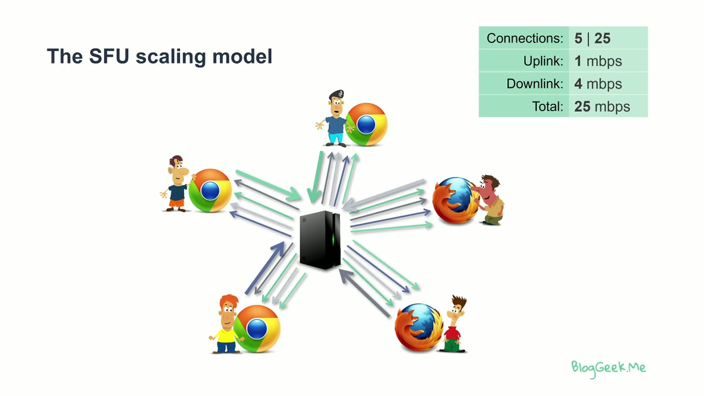
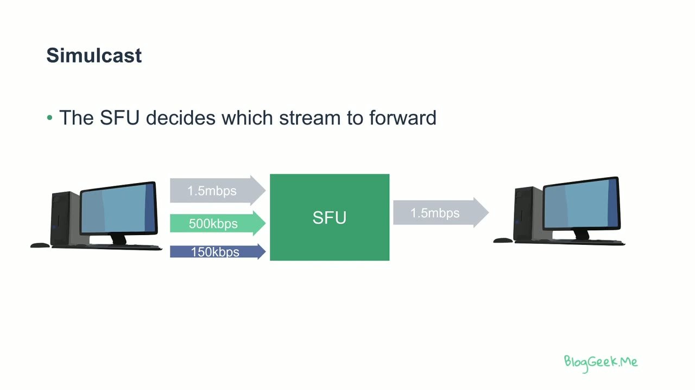

# 第 57 章 优化大型群组通话

大型群组通话的优化可以看作逐层剥开洋葱：先处理信令与传输，再处理编解码器和媒体，并分别审视视频与音频。课程把这些已有工具重新组织起来，核心目标只有两个——降低 CPU 负载和网络压力。服务器需要关注这两项资源，浏览器等客户端通常更加敏感；客户端的策略也会反过来决定服务器应当怎样工作。

## 群组越大，架构越复杂

不同规模需要不同工具：

- 两人会话可以直接采用点对点连接。
- 五人或十人通话通常需要 SFU 来选择和转发媒体流。
- 一百人左右的会话仍可能以 SFU 为主。
- 达到一千人或一万人时，就要考虑 SFU 级联及其他扩展方案。

这些数字表示复杂度增长的方向，而不是任何媒体服务器的统一容量。人数增加后，不能只把同一套小会议配置原样复制，必须逐步引入更多优化。

## 朴素 SFU 模型的连接与解码压力

SFU 的基本模型是：每个用户把媒体发送到服务器，服务器再选择性地决定向谁转发哪些内容。课程用五人通话说明朴素实现的代价：假设每名用户上行发送 1 Mbps、下行接收 4 Mbps；如果按每名用户建立 5 条 PeerConnection 的方式估算，全场就有 25 条连接，收发数据量合计约 25 Mbps。

这里不能只把 4 Mbps 下行看作带宽问题。客户端还要解码所有传入视频，普通双核机器未必能理想地承担这种工作。因此，媒体流量最终同时体现为网络成本和解码 CPU 成本。

这个估算的价值在于暴露朴素模型的扩展趋势，而不是提供可直接套用到所有 SFU 的容量公式。

*图：朴素 SFU 模型的资源估算（课程幻灯片，00:02:40）。*

## 信令与传输：先减少 PeerConnection

### 建立连接本身就很有成本

一次典型的 PeerConnection 协商，会围绕 `setLocalDescription`、`onicecandidate`、`addIceCandidate`、`setRemoteDescription` 等 API 产生信令收发。此外，本地和远程 ICE 候选地址还要两两配对，执行 ICE 连通性检查。

课程分析的一份 AppRTC 转储中，单次连接出现了十多条往返信令消息和 12 个 ICE 候选对。该环境只配置了一个 STUN 服务器、一个 TURN UDP 服务器和一个 TURN TCP 服务器，没有 IPv6 候选，也没有 TURN TLS；如果继续增加配置，候选和检查还可能更多。

由此得到一条直接建议：**把 ICE 服务器列表中的 TURN 服务等配置缩减到实际需要的最低限度。**更多服务器并不自动意味着更好的连接效果，反而可能增加候选组合和建立连接的复杂度。

### 并行建立大量连接会引发重试风暴

加入一个已有十名其他参与者的会议时，如果采用“每个远端参与者一条 PeerConnection”的模型，新客户端就要同时建立十条连接。浏览器和机器需要处理大量消息，它们分布在不同的 TCP、UDP 套接字上，可能造成连接失败和重试。

更麻烦的是部分连接成功、部分连接失败的中间状态。系统随后重试失败连接，又会进一步加重网络压力，使建立过程更加不稳定。PeerConnection 在建立阶段十分“健谈”，大量并行建立会放大这一特点。

### 首选每台媒体服务器一条连接

传输层的第一项优化，是重新确认大型通话究竟需要多少条 PeerConnection，并尽量减少数量：

- 不要为每个远端客户端各建一条到同一媒体服务器的连接。
- 尽量做到**每台媒体服务器一条 PeerConnection**。
- 如果本来需要五条连接接收五路媒体，应改为在同一条连接上承载这五路输入流。

最合适的 SFU，应当能够在单个 PeerConnection 上处理会议所需的全部媒体。

如果现有媒体服务器不支持这种模型，必须在加入会议时限制建立速度。例如，会议中已经有 10～20 人，需要建立 20 条连接时，应先连接正在积极发言和参与的人，等待一两秒，让这些连接进入已连接状态，再逐步连接其余人。这样虽不如单连接方案理想，却能避免一次性并行建立全部连接。

## 视频优化：给 SFU 更多可选版本

大型会议中的用户并不相同：有人带宽很低，有人设备性能较差，有人使用移动终端，也有人通过光纤入户接入。他们的窗口布局和希望观看的内容也不一样。

优化的目标不是让所有人降到最低共同标准，而是给 SFU 足够多的媒体选项，使其能分别为不同用户选择合适的体验。

### Simulcast 提供码率维度

联播（simulcast）允许发送端把同一视频以两三种不同码率发送到 SFU。SFU 收到这些版本后，可以根据接收端网络、设备和布局，选择高、中或低码率版本转发。

没有 simulcast 时，SFU 只有收到的那一个比特流可供转发；采用三个 simulcast 层级后，就有了三种选择。这是第一个灵活性维度。

*图：Simulcast 为 SFU 提供码率选择（课程幻灯片，00:08:29）。*

### 时间可扩展性提供帧率维度

要理解第二个维度，需要先理解视频帧依赖。一个 I 帧之后通常跟着一系列 P 帧：P 帧依赖此前的帧，形成一条依赖链。如果其中一帧丢失，后续依赖它的帧就可能无法使用，需要请求新的 I 帧恢复。参与者越多，这类恢复出现得越频繁，视频质量越容易受影响；但频繁发送 I 帧又会消耗更多带宽和 CPU，因为 I 帧本身更大。

时间可扩展性（temporal scalability）把编码组织成不同时间层。课程以 VP8 的 L0、L1 为例：L0 构成基础层，后续 L0 帧不必依赖紧邻的前一个 L1 帧；L1 则提供增强。一个 30 fps 的流去掉全部 L1 帧后，仍能留下可解码的 15 fps 流。

这带来一定鲁棒性，对 SFU 更重要的是：SFU 可以接收 30 fps，却只向某个接收端转发 15 fps，而不必先对视频转码。

按课程录制时所述，这里讨论的能力组合限 VP8，并与 simulcast 一起使用，H.264 不具备相同的这一组合；Chrome 曾有三个时间层，课程时已变为两个。若三个 simulcast 码率层级各自提供 30 fps 和 15 fps 两种选择，SFU 的备选就从三个增加到六个：

| 发送端能力 | SFU 可选择的典型版本 |
| --- | --- |
| 单一编码流 | 只有原始比特流 |
| 三个 simulcast 层级 | 低、中、高三个码率版本 |
| 三个 simulcast 层级加两个时间层 | 每个码率版本再提供 30 fps 或 15 fps，共六种选择 |

选择越多，SFU 越能适应不同网络、设备与屏幕布局。

## 发送端与接收端如何共同选择媒体

Simulcast 和时间可扩展性不是打开开关后就结束，还要持续根据实际消费情况调整。

### 发送端需要回答的问题

- **CPU 和上行带宽是否足够？**能否编码并发送三层，还是只能发送两层甚至一层？
- **摄像头提供的最大分辨率是多少？**如果摄像头只有 VGA，可能两层就足够，不必机械追求三层。
- **是否有人观看自己的流？**无人观看时，可以停止发送，或只保留最低质量的 15 fps 流。
- **观众实际消费哪些码率？**若所有人都只看高档，可以不再发送无人使用的低档；若无人观看高档，也可暂停高档。
- **远端以多大分辨率显示自己？**如果所有人都把自己显示在小窗口中，就没有必要继续发送高分辨率、高码率版本。
- **观众的可用带宽如何？**观众只能接收低码率时，发送高档没有价值。

发送端因此可以只生成和发送真正有人消费的 simulcast 版本，并调整编码器设置，而不是始终固定发送全部层级。

### 接收端需要回答的问题

- 这个流有哪些可用码率，当前有哪些可选项？
- 本地把它显示在大窗口还是小窗口，实际需要多少像素？
- 这路流有多重要？不重要时可以降到 15 fps，甚至不显示、不接收。
- 同时还要显示哪些流，它们之间的优先级如何？重要内容应优先获得资源。
- 总下行带宽是多少？所有接收流必须共享它。
- 本地 CPU 是否能承担当前解码任务？负载过高时必须主动减少工作量。

这是一场发送端与接收端协同的资源分配，而不是 SFU 单方面猜测。

### 动态调整层级及其代价

Simulcast 层不必从会议开始到结束都固定为三层。发送端可以暂停某一层，之后恢复，也可以动态减少、增加或修改层级，调整其码率、帧率和分辨率。

课程常见的是两层和三层，三层只是建议而非硬性标准；没有见过四层，并不构成刻意采用四层的理由。还要注意，这类变化可能需要 SDP 协商或重新协商，优化媒体资源的同时不能把信令成本忽略掉。

## 码率、分辨率和帧率的取舍

假设一路视频最初为 500 kbps、VGA 分辨率、30 fps，而当前网络无法承载。降低码率至少有两种方向：

1. **降低分辨率，保留 30 fps**：优先保持运动流畅。课程示例把调整后的码率写为约 30 kbps，这个数字只是说明调整方向的孤立示例，不是分辨率与码率之间的通用换算关系。
2. **保留 VGA 分辨率，把帧率从 30 fps 降到 15 fps**：优先保持单帧画面的清晰度，而不是运动连续性。

展示人物并强调彼此互动的应用，通常会尽量长时间保持 30 fps，先调整其他参数；对不发言、已静音的头像画面，可以降到 15 fps。屏幕共享也经常更重视清晰度，尤其是以幻灯片为主时。屏幕共享本身通常已经采用可变帧率和码率，其编码行为与人物头像视频不同，不能直接套用同一策略。

## 避免无效缩放

假设摄像头以高分辨率采集，发送端按高分辨率编码，接收端完整解码后，却把视频放进一个很小窗口并缩小显示。这个过程中，带宽、高分辨率解码和缩小处理都消耗了资源，最终用户却只看到小画面。在大型群组通话中，这种浪费会被多路视频进一步放大。

原则是：**只传输实际需要的分辨率，不多传一个像素。**

课程还展示了相反方向的取舍：先发送较低分辨率图像，再在显示端放大，甚至放大两倍。这样会损失清晰度，但节省带宽和解码资源；其离线示例用来说明，在动态视频中，这种清晰度损失未必像静态图片对比那样显眼。工程上应检查实际显示效果，而不是一律追求最高采集分辨率，也不是一律把图像放大。

## 音频扩展：不能把所有人的流全部收下

视频通话中最重要的仍是语音质量。音频与视频的扩展压力并不相同：Opus 的编码和解码也有成本，但视频处理通常更重；课程用约 40 kbps 的一路语音和约 2 Mbps 的一路视频作对比，视频也无法像语音那样轻易降到几十 kbps。

另一个差别是“同时可消费的人数”。视频画面同时显示 20、50 或 100 人之后，再继续增加通常没有实际意义；音频会议却可能希望容纳远超这个数量的参与者。视频会议也可以有同样多的参会者，只是不会把所有人同时显示在屏幕上。

如果简单接收所有其他人的 Opus 音频，课程给出的下行估算是：

- 两人通话时，接收另一人的约 40 kbps。
- 四人通话时，接收其他三人的约 120 kbps。
- 两千人通话时，按同样的朴素模型接近 80 Mbps。

即使光纤入户网络，也不应把这种增长视为合理的实时会议方案。课程进一步以约 4 Mbps 作为实时服务不应无节制越过的示例界限。两千人不可能同时有效发言，因此优化方向是只传输当前有用的音频，并降低沉默用户和大量小包的固定开销。

## 按发言状态增删连接：可用但代价明显

一种办法是关闭几秒没有发言者的 PeerConnection，在对方希望取消静音或开始说话时重新建立。这样可以避免长期维持所有音频连接，但课程明确把它视为不理想的办法。

重新加入一条 PeerConnection 可能需要约一秒甚至更久，还伴随约十条网络消息，并可能建立失败。由此产生两类问题：

- **丢失开场语音**：对方开始讲话时，连接尚未恢复，最初一两秒可能直接丢失，而这部分可能很重要。
- **用户体验不清晰**：系统不能悄悄把用户静音，再自动解除静音。用户需要理解自己何时被静音、何时恢复，否则会把连接重建过程误认为故障。

如果不得不采用此方案，就必须把这些行为和状态明确纳入交互设计，而不能只把它当作后台资源优化。

## 自适应 ptime：减少包数量，增加等待

当参与者超过约 40～50 人，又希望在单个 PeerConnection 上承载所有用户的输入音频通道时，数据包速率会成为独立瓶颈。自适应 ptime 是课程提出的一种优化方向，在课程录制时仍在完善。

假设一条 PeerConnection 承载十个人的音频，Opus 每 20 ms 发送一个包：

- 单人是每秒 50 个包。
- 十人合计是每秒 500 个包。
- 即使总码率不高，包数量本身也会消耗 CPU 和网络资源。

自适应 ptime 可以把多个音频帧合并进更大的包。例如，不再分别发送两个包，而是在一个包中携带两帧。收益有两层：发送的包更少，包头及 RTP 头部的相对开销也降低。音频包通常较小，因此这种固定开销不能忽略。

代价是为了组包必须等待，可能增加延迟。如果会议同时包含视频，音频为了唇音同步本来就可能等待视频，这种额外延迟的影响需要结合同步过程评估，而不能只看音频包速率。

## DTX：沉默时停止常规发送

不连续传输（Discontinuous Transmission，DTX）利用了“多数人并不会一直说话”这一事实。Opus 支持 DTX，WebRTC 也提供相应支持。

按课程示例，正常发送时每秒有 50 个包；启用 DTX 后，不说话时不再持续发送常规音频包，而是约每 400 ms 发送一个表示无发言的包，即每秒约 2.5 个包。按这两个数字计算，沉默用户的包速率约降到原来的二十分之一。

大型群组通话应启用 DTX。它不仅减少客户端流量，也会显著减轻 SFU 的转发压力：十人会议中若只有一人发言，其余九人大部分时间都处于 DTX 状态，SFU 不必持续处理九路完整的常规音频包流。

DTX 可以与前述其他优化并行使用，因为它解决的是沉默时的固定开销，而不是视频版本选择或连接数量问题。

## 浏览器混音行为与 SFU 的音量选择

课程描述的浏览器 WebRTC 混音过程是：接收多路音频并解码，最终只混合音量最高的三条音轨。也就是说，接收十个人的音频，并不意味着浏览器会把十路全部混进最终输出。

由此可以推导出一项 SFU 优化：

1. SFU 通过数据包头中的音量信息判断当前较活跃的音轨。
2. 只选择最需要的三路发送。
3. 对其他音轨采用或替换为 DTX 状态，避免为最终不会被混出的声音持续消耗资源。

这里描述的是课程中的浏览器行为与优化思路，不应未经核实就当作所有浏览器、所有版本的永久统一限制。该方案实现起来比单纯开启 DTX 更复杂，但能把 SFU 的转发选择与浏览器实际混音行为对齐。

## 小结

大型群组通话优化应遵循明确顺序：

1. **传输层**：精简 ICE 配置，优先每台媒体服务器一条 PeerConnection；无法做到时，分批建立连接。
2. **视频层**：用 simulcast 提供码率选项，用时间可扩展性提供帧率选项，并根据实际观看、布局、带宽和 CPU 动态调整。
3. **编码参数**：在运动流畅与画面清晰之间选择，避免高分辨率传输后再缩小显示的资源浪费。
4. **音频层**：避免按总人数无差别接收全部流，谨慎对待连接增删造成的语音丢失，利用自适应 ptime、DTX 和音量选择减少包速率与固定开销。

这些技术共同服务的不是某一个码率数字，而是在参会人数增加时，仍把客户端 CPU、网络和服务器的资源用于用户真正能看见、听见的内容。
