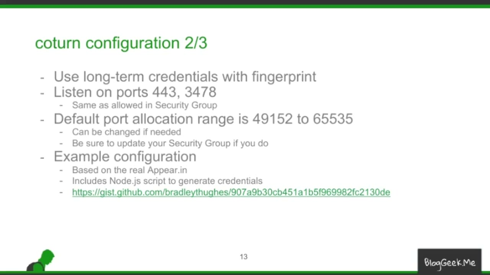
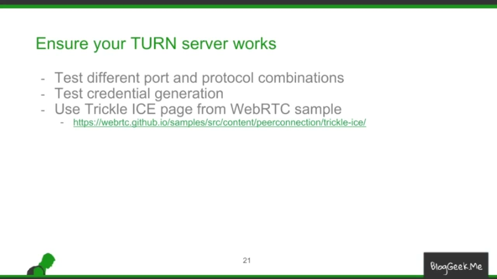
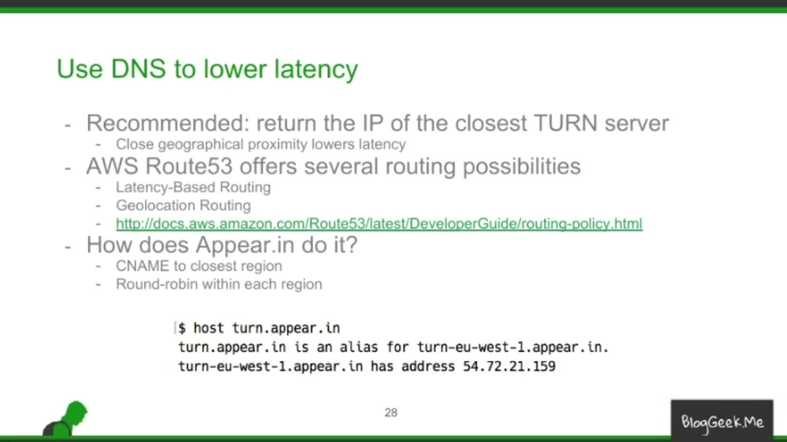

# 第 76 章 在 AWS 上部署（co）TURN

在 WebRTC 服务中，TURN 服务器必须位于公共互联网上，才能在两个客户端无法直接连接时转发媒体。把 coTURN 部署到 AWS，并不只是启动一台 EC2、安装软件这么简单：VPC 是否连通公网、安全组是否覆盖控制与中继端口、服务器能否识别自己的公网地址、凭据是否会过期、证书链是否完整，以及旧实例能否平稳排空，都会直接影响生产可用性。

本章按照课程讲师 Bradley Hughes 的生产实践，依次完成安装、AWS 网络与实例配置、coTURN 访问控制、TLS、连通性测试和上线运维。课程以 appear.in 的基础设施为例；其中实例系列、软件能力和证书更新节奏均是课程录制时的状态，实际部署应保留这里的验证方法，而不把历史默认值当作永久结论。

## 部署流程与 coTURN 项目

一套可投入生产的部署大致要经过以下步骤：

1. 安装 coTURN；
2. 配置 AWS 的 VPC、子网、路由、访问控制和公网地址；
3. 创建 EC2 实例并配置安全组；
4. 让 coTURN 正确使用公网与私有 IP，并配置限时凭据；
5. 检查文件描述符、网络限制和启动自动化；
6. 配置 TLS 证书与监听；
7. 分别测试 STUN、TURN over UDP、TURN over TCP 和 TURN over TLS；
8. 通过 DNS 将多个实例投入服务，并建立排空、监控、扩缩容和成本控制流程。

coTURN 是一个成熟而功能丰富的项目，源于最初的 RFC 5766 TURN Server 项目。原项目曾托管在 Google Code，Google Code 关闭后，代码被迁移到 GitHub。课程建议利用其 GitHub Wiki 查阅运行方式、命令行选项、配置选项、性能和负载均衡资料。

## 安装：优先选择可自动化的软件包

如果操作系统已有预构建软件包，讲师优先推荐直接安装软件包，而不是先从源码构建。原因不只是省去编译步骤，更重要的是：

- 通常只需少量命令即可完成安装；
- 更容易纳入自动部署和持续部署；
- 新实例可以通过一致的流程重复构建。

课程提供了 Debian 软件包仓库和 FreeBSD 安装方式的资料，讲师所在团队也曾在一段时间内使用 FreeBSD 运行 TURN 服务器。确有需要时，也可以按 GitHub 上的说明从源码构建。安装时应根据目标操作系统选择相应仓库或官方安装说明，避免混用不同发行版的命令。

## AWS 网络：让中继服务真正位于公网

### VPC 需要同时具备入站与出站能力

AWS 的虚拟私有云（VPC）是一张逻辑隔离的虚拟网络。实例在其中通常获得私有 IP，但这并不足以提供 TURN 服务：服务器既要接受互联网客户端的连接，也要向外转发数据。

因此，VPC 及其子网至少需要正确配置：

- **路由表**：提供通往互联网的路由；
- **网络访问控制列表（网络 ACL）**：允许所需的入站与出站流量；
- **互联网网关**：让流量能够进出公共互联网；
- **公网 IP 分配**：让客户端拥有可访问的服务器地址。

创建 AWS 账户时通常会获得默认 VPC，以及各区域、各可用区的默认子网。课程建议检查这些默认资源，确认无误后也可以直接使用，因为它们通常已按实例直接访问互联网的需求配置。

### 安全组必须覆盖控制端口和中继端口

安全组是 AWS 的虚拟防火墙，用入站和出站规则决定实例能接收、发送什么流量。课程中的 TURN 安全组配置如下：

| 用途 | 端口或范围 | 协议与方向 | 配置要点 |
|---|---|---|---|
| TURN 控制连接 | 3478 | UDP、TCP 入站 | 客户端与 TURN 服务器通信的基础控制端口 |
| 受限网络接入及 TLS | 443 | UDP、TCP 入站 | 443 更容易穿过代理或防火墙；TURN over TLS 测试使用 TCP |
| TURN 中继分配 | 私有使用范围，课程所述为 49152～65535 | UDP、TCP 入站（按实际启用的中继配置收紧） | 服务器为分配随机选择端口，只开放控制端口并不够 |
| 中继出站流量 | 课程示例为全部允许 | 出站 | 避免服务器无法向目标方向转发数据 |

443 与 3478 是客户端同服务器建立控制通信的端口，而实际媒体中继还会使用服务器分配的端口。只放行前两个端口，可能出现“能连上服务器，却无法正常中继”的问题。

coTURN 的默认分配范围位于私有使用端口区域。若通过配置改变中继端口范围，必须同步更新安全组和主机防火墙，确保新范围没有被阻塞；不能让服务器配置与实际放行的范围相互矛盾。

## EC2 实例：创建参数与网络能力

### 创建时必须选对的项目

启动 EC2 实例时，应完成以下检查：

1. 使用前面已经确认能够访问互联网的 VPC 和子网；
2. 关联刚配置的 TURN 安全组；
3. 在控制台启动向导中启用 **Auto-assign public IP（自动分配公有 IP）**；
4. 确认实例最终能够通过公网地址提供服务。

安全组以后仍可调整，创建时忘记关联并非无法补救。但按课程所述，VPC、子网及公网 IP 相关选择必须在创建时处理正确；如果网络位置选错，就需要销毁并重新创建实例。

### 不必追求大磁盘，更应关注网络

coTURN 本身通常不需要很大的磁盘或内存。RTP 数据包一般较小，多数通过 UDP 中继，大小通常低于 MTU 限制。因此，单纯选择大存储、大内存实例，不一定能改善 TURN 服务。

媒体中继更依赖网络能力，而延迟又是高质量实时视频服务的关键。课程建议使用 AWS 的增强型联网（enhanced networking）：部分实例系列可借此获得更高的网络带宽和每秒数据包处理能力。讲师所在团队当时使用 C4 系列，但仍建议通过自己的测试确定最适合的实例类型，而不是直接照抄这一历史选择。

## coTURN 基础配置

### 让服务器知道公网与私有地址

coTURN 需要知道自己用于中继数据的公网 IP，但 VPC 内的操作系统通常只能看到实例的私有 IP。因此，配置过程必须把两种地址都弄清楚：

1. 通过 EC2 实例元数据查询公网地址；
2. 同时查询私有或本地地址；
3. 在 coTURN 配置中建立正确的地址关系，明确告诉 TURN 服务器：虽然本机只看到私有地址，但实际应使用对应的公网地址中继数据。

课程材料展示了元数据查询方法；实际命令应与所使用的 EC2 元数据版本及官方文档保持一致。关键要求是：**不能直接把操作系统看到的私有 IP 当作公网中继地址。**

实例 IP 发生变化时，相关配置也必须重新生成。这也是后文启动脚本需要自动完成的工作之一。

### 用共享静态密钥生成限时凭据

课程采用共享静态认证密钥来生成有时间限制的 TURN 凭据。其目标是避免发放长期有效、被窃取或嗅探后可一直滥用的用户名和密码。

这种架构把凭据生成与验证分开：

- 服务后端持有密钥并生成凭据；
- TURN 服务器使用同一密钥独立验证；
- 后端与 TURN 服务器之间不需要为每次验证建立直接连接；
- 客户端只能在指定时间段内使用生成的凭据。

生成过程如下：

1. 构造用户名，在其中包含过期时间戳；时间戳使用自 Unix Epoch 以来的秒数表示有效期终点；
2. 使用该用户名计算 HMAC-SHA1；
3. 对结果进行 Base64 编码，编码结果就是密码；
4. 配置 TURN 服务器使用带指纹（fingerprint）的长期凭据机制，使其能够按共享密钥验证上述数据。

课程配套材料包含基于其生产配置的示例配置文件，以及一个用于生成测试凭据的小型 Node.js 脚本。本章聚焦凭据生成逻辑与配置职责，不展开脚本源码。后文测试所用的示例凭据有效期为四小时。

### 监听端口与启动方式

课程配置让 coTURN 同时监听 443 和 3478。3478 是常规服务端口，443 则用于提高受限网络中的可达性：代理或防火墙往往更容易允许 443 上的连接，从而降低用户完全无法使用服务的可能性。

*图：coTURN 基础配置要点（课程幻灯片，00:11:33）。*

讲师建议把各项设置写入配置文件，再使用 `-c` 选项启动 `turnserver` 并传入该文件的路径，而不是依靠一长串临时命令行参数。监听 443 这类端口时，可能需要 root 或其他特权方式。课程也指出，并非只有直接以 root 运行这一条路，但没有展开具体替代实现。

## 操作系统限制与启动自动化

### 文件描述符决定可承载的会话规模

最容易被忽略、也是讲师特别强调的一项，是 EC2 实例可用的文件描述符数量。可用文件描述符越多，服务器能够承载的中继流量和会话通常也越多。

课程遇到过的低限制案例是：

- 可用文件描述符只有 1024；
- STUN 与 TURN 会话合计只能创建约 500 个；
- 服务容量很快达到上限并发生故障。

启动 coTURN 时，应检查它输出的两项信息：检测到的文件描述符数量，以及由此计算出的理论最大会话数。如果上限异常低，应在上线前调整，而不是等生产流量达到瓶颈后才发现。

### FreeBSD 网络参数

在 FreeBSD 上，课程还检查了网络限制。讲师所在团队调整了 TCP backlog，以及与连接重置有关的 ICMP 限制，使系统能够比默认设置更快地处理连接。这些属于需要结合连接目标验证的操作系统调优项，具体参数值应根据官方文档和容量测试确定。

### 用启动脚本消除手工漂移

启动脚本或其他自动化机制应承担以下工作：

- 实例启动后自行发现公网 IP；
- 在 IP 变化时重新生成相关配置；
- 写入最新 coTURN 配置；
- 启动服务器并让新实例投入服务。

安装软件和写一份配置文件本身并不难，真正困难的是让一台新实例无需人工干预就能完成整个流程。自动化既减少配置漂移，也决定集群能否快速扩容和替换。

## TLS：穿透能力之外，更要处理证书生命周期

### 为什么单独考虑 TLS

在 443 端口启用 TLS，可以进一步提高受限防火墙或代理环境下的连接成功率。但 TLS 并不是简单打开一个监听选项，还必须准备有效证书、完整证书链，并设计更新期间不中断服务的方式。

取得证书的一般过程是：生成私钥和证书签名请求（CSR），再按证书颁发机构（CA）的流程提交并取得证书。生成操作应遵循 CA 与所采用 OpenSSL 版本的官方流程，并妥善保护私钥。

### 证书更新不能靠随意重启解决

课程问答专门讨论了 Let's Encrypt。按当时的讨论前提，证书大约每月需要更新，而 coTURN 当时尚不能动态重新加载或替换运行中的证书。这意味着更新证书至少需要重启服务器。

TURN 与短生命周期 HTTP 请求不同：其中继会话有状态，可能持续很久，直接停止进程会中断现有媒体。因此，证书更新实际上也是一个实例替换与会话排空问题。

课堂讨论了几种应对思路：

- 等 coTURN 具备运行时动态替换证书的能力；作为开源项目，也可以由社区实现；
- 如果部署已充分自动化，可以约每三周替换一次实例，让新实例在启动过程中取得新证书，避免旧实例运行到证书失效；
- 新服务器与旧服务器并行运行，旧服务器不再接收新分配，等待既有会话逐步结束。

旧会话可能持续数天，所以交接时间不能预先假定为几分钟。课程还提到一种业务策略：限制单个 TURN 会话最长不超过六小时，为排空设置可控边界；按讲师给出的估算，这样可以在开始排空后的约十二小时内停止旧服务器。这里的关键不是照搬时长，而是用明确的会话策略换取可预期的维护窗口。

### 证书链不完整是常见陷阱

取得证书后，应把**已签名证书与全部中间证书合并到同一个证书文件**，再交给 coTURN。如果证书由中间 CA 签发，却遗漏中间证书，客户端可能无法验证服务器证书。讲师把这一点称为自己及他人反复遇到的最大陷阱之一。

### TLS 可以复用现有端口，不需要另开端口

配置好私钥和证书后，可以启用 TLS 监听，并继续使用正常服务已经使用的 443 和 3478。coTURN 能识别套接字上是否发生 TLS 协商，因此无需仅为 TLS 再增加一组监听端口。

还应完成两项配置检查：

- 让 coTURN 使用正确的证书文件和私钥；
- 显式设置密码套件列表（cipher list），而不是直接沿用 OpenSSL 默认列表。

课程指出，使用默认 OpenSSL 密码套件列表时，在 Qualys SSL Labs 等评分页面上可能得不到理想结果。其示例采用当时推荐的 AWS 默认密码套件列表，讲师当时预期可获得 A 级评分，客户端浏览器也能支持。具体密码套件应按部署时的安全基线和客户端兼容性配置；这一评分只代表课程录制时的配置背景。

## 上线前测试：逐层证明网络、分配与 TLS 都正常

测试不能只以“进程已启动”为终点。课程使用典型的 ICE WebRTC 示例，按协议和端口逐层验证，并观察最终收集到的 ICE 候选类型。

### 测试矩阵

| 测试层级 | 服务器与端口 | 传输方式 | 凭据 | 主要验证目标 |
|---|---|---|---|---|
| STUN | EC2 公网 IP，3478 | 按 STUN 测试方式 | 不需要认证 | 是否获得服务器反射候选 |
| TURN | `turn` 方案，公网 IP，3478 | UDP | 脚本生成的用户名和密码 | 是否成功建立 TURN 分配并获得中继候选 |
| TURN | `turn` 方案，公网 IP，3478 | TCP | 可复用上述未过期凭据 | UDP 被阻止时能否通过 TCP 中继 |
| TURN over TLS | `turns` 方案，DNS 域名，443 | TCP | 可复用上述未过期凭据 | 严格网络下能否通过 TLS 建立中继 |

*图：TURN 上线前的测试方法（课程幻灯片，00:21:12）。*

在 TURN UDP 测试中，课程将 `turn:`、IP 地址和端口 3478 填入 URI，并指定 UDP 传输，再填入脚本生成的用户名与凭据。切换 TCP 测试时，只需把传输方式从 UDP 改为 TCP；示例凭据有效期为四小时，因此无需为这一改动重新生成。

### 第一步：先验证无需认证的 STUN

TURN 包含 STUN 能力。按课程配置，服务器允许无需认证的 STUN，因此可以先用 EC2 公网 IP 和 3478 端口测试。

如果获得服务器反射候选（server-reflexive candidate），至少说明：

- 服务器存在且能够响应；
- 相关防火墙路径可用；
- 客户端可以通过该服务发现反射地址。

但这一步还没有证明 TURN 凭据正确，也没有证明中继分配成功。

### 第二步：验证 TURN over UDP

使用生成的用户名和密码请求 TURN 分配。由于 TURN 服务器同时具有 STUN 能力，课程示例中既能看到服务器反射候选，也能看到通过 TURN 分配获得的中继候选；该示例展示了两条中继候选。

诊断重点是确实出现 `relay` 类型的候选，而不是只看到服务器反射候选便误以为 TURN 已验证成功。候选的具体数量与测试环境有关，不应把“两条”当成所有部署的固定结果。

### 第三步：验证 UDP 被阻断时的 TCP 路径

保留服务器地址、端口和未过期凭据，把传输方式改为 TCP，再次收集候选。如果仍能通过 TCP 连接取得 TURN 中继分配，就证明该备用路径可用。

### 第四步：验证 443 上的 TURN over TLS

TLS 测试不能再只使用裸 IP。客户端使用的域名必须与 TLS 证书中的通用名称（Common Name）匹配，因此要先在 DNS 中为服务器配置正确的域名，再使用：

- `turns` 方案，而不是 `turn`；
- 已配置且与证书匹配的域名；
- 443 端口；
- TCP 传输；
- 前面生成且仍在有效期内的凭据。

课程的备用 EC2 实例没有 DNS 记录，因此这一部分使用其生产基础设施演示，并成功生成中继候选。若 TLS 测试失败，应同时检查证书域名、完整证书链、443 入站规则和 TLS 配置，而不能只检查 TURN 密码。

## 投入生产：DNS 负载均衡与有状态排空

### 用 DNS 分散多个实例的负载

单个实例无法承载所有 TURN 负载时，需要把流量分散到多个实例。课程比较后采用基于 DNS 的负载均衡，原因是它最简单，而且客户端都能支持。

基本做法是把多台 TURN 服务器放在同一个域名后面，通过轮询 DNS（round-robin DNS）让负载在集群内较为均匀地分布。讲师所在团队当时将全球 TURN 服务器统一放在其 TURN 服务域名之后。

### 删除 DNS 记录不等于流量已经消失

TURN 会话正在持续转发数据，是有状态会话，不能像无状态 HTTP 服务那样从负载均衡中摘除后立即终止。

下线的正确顺序是：

1. 从 DNS 中移除旧实例的 IP，避免继续分配新会话；
2. 保留实例，等待既有会话逐步排空；
3. 必要时等待数天，或等到业务设定的会话时长上限；
4. 确认流量已消退后，再终止实例并清理资源。

相应的版本或集群替换流程是：先启动新实例并加入 DNS，再移除旧实例，让旧实例排空；课程实践通常在一两天后完成旧实例的终止和清理。扩容、证书替换和版本更新都可以复用这一思路。

## 用 Route 53 选择低延迟区域

实时媒体对延迟敏感。一般而言，让 DNS 返回地理位置更近的 TURN 服务器，可以降低传输延迟。讲师以挪威西海岸为例，较近路径可能指向 AWS 的法兰克福、伦敦或爱尔兰区域。

AWS Route 53 提供课程讨论的两类路由方式：

- 基于延迟的路由（latency-based routing）；
- 基于地理位置的路由（geolocation routing）。

讲师所在团队采用两级名称结构：

1. 统一的 TURN 服务名称通过 CNAME 指向离客户端较近的区域名称；
2. 在该区域内部，再通过轮询 DNS 分散到各 EC2 实例。

例如，统一名称可以先指向爱尔兰区域名称，后者再返回某个爱尔兰 EC2 实例的地址。

*图：通过 DNS 降低 TURN 路径延迟（课程幻灯片，00:26:38）。*

团队当时选择基于延迟的路由，一部分原因是地理路由推出时其基础设施已经建立，也因为直接优化延迟更符合服务目标。不过，这种路由依据的是到 DNS 基础设施的延迟，再据此推断到 TURN 区域的路径也可能较低。它是一种通常有效的近似，而不是对实际媒体路径延迟的绝对保证。

## 运维自动化、监控与成本

### 自动化是逐步演进出来的

讲师所在团队并非一开始就拥有完整系统，而是经历了渐进过程：

1. 最初只在爱尔兰运行一台 TURN 服务器，以手工方式管理；
2. 实例增长到约三台后，开始加强自动化；
3. 最终可以通过命令扩大集群，例如把规模翻倍并让新实例加入 DNS；
4. 再执行另一流程标记并移除准备排空的旧实例；
5. 约一天后缩小集群，清理已经过时的资源。

课程没有提供这些内部命令的名称或语法，因此这里只保留流程，不虚构命令。真正值得复用的是“创建—加入—摘除—排空—清理”的状态流转，而不是某个脚本外观。

### 监控不只看进程是否存活

按课程所述，coTURN 默认会在本机 localhost 打开一个用于查询指标和数据的端口。团队利用它报告实际运行的会话数量，并统计客户端通过 UDP、TCP 或 TLS 接入的情况。

这类指标能够回答单实例容量、协议分布和排空进度等问题。课程没有给出该端口号码或具体指标字段，因此部署时不应从本章推造相应配置值。

### 不要忘记 EC2 出站流量费用

实例按小时计费很容易理解，但讲师特别提醒，EC2 向外发送的数据也会产生费用。TURN 是中继：如果客户端以高码率向 Amazon 发送数据，服务器通常也要以高码率把数据转发出去，从而带来可观的出站流量成本。

因此，运维上既要防止客户端让 TURN 服务器过载，也应在能够控制客户端行为时限制使用 TURN 的入站码率。降低不必要的入站码率，不只是节省带宽，也会减少中继出站数据及相关费用。

## 小结

一套可靠的 AWS coTURN 部署，需要同时满足以下条件：

- VPC、子网、路由表、网络 ACL 和互联网网关共同提供公网出入能力；
- 安全组不仅开放 3478、443，还覆盖实际中继分配端口范围；
- EC2 创建时选对网络与公网 IP，实例选择重点考虑带宽和每秒包处理能力；
- coTURN 正确关联公网与私有地址，后端和服务器通过共享密钥生成、验证限时凭据；
- 文件描述符和系统网络限制经过检查，启动脚本能够自动更新地址和配置；
- TLS 使用有效私钥、完整证书链和明确配置的密码套件，并通过并行实例与排空处理证书更新；
- 测试依次证明 STUN、TURN UDP、TURN TCP 和 TURN TLS 都能获得预期候选，尤其要确认真正的中继分配；
- 生产环境通过 DNS 和 Route 53 分布负载、选择区域，旧实例先摘流量再排空，不能贸然终止；
- 监控会话与协议分布，并把出站流量费用纳入码率和容量管理。

安装 coTURN 只是起点。真正决定服务质量的是网络、凭据、证书、测试和自动化运维能否组成一个可重复、可验证、可平稳替换的完整体系。
